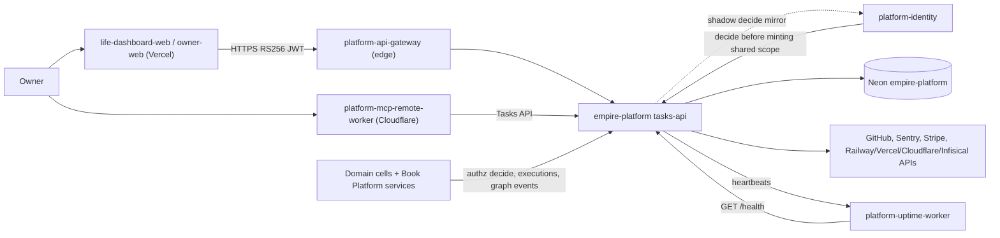
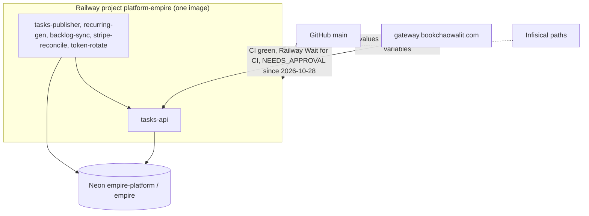

# Empire Platform — System Architecture

เอกสารนี้สรุป architecture ของ empire-platform จากโค้ดบน `origin/main` `51c8ad3` (2026-11-04) และชุดภาพ Core 22 ใน [`docs/diagrams/`](../docs/diagrams/README.md) (วาดที่ `686089a`, หลังจากนั้นมีแค่ commit `16b5349` ที่เพิ่ม audience `ai-api`) รายละเอียดเชิงลึกอยู่ในไฟล์ที่ลิงก์ ไม่ copy ซ้ำ

## 1. Architecture style และเหตุผล

- **Modular monolith ใน monorepo เดียว, deploy เป็นหลาย process จาก image เดียว**: `services/` (platform, tasks, graph, mcp) + `packages/authz` + `src/empire_platform` (jobs/CLIs) build เป็น `Dockerfile` เดียว แต่ละ Railway service เลือก process ด้วย `EMPIRE_SERVICE` หรือ `startCommand` ([ADR-0004](../docs/diagrams/08-adr/ADR-0004-one-image-railway-cd-wait-for-ci.md))
  - เหตุผล: เจ้าของคนเดียว, โค้ด authz/tasks/graph ใช้ schema และ role ชุดเดียวกัน, deploy ครั้งเดียวได้ทุก process ที่ version ตรงกัน
- **Control plane กลาง (PDP) + database-enforced security**: ทุกการตัดสินสิทธิ์ผ่าน `platform.authorize` ใน PostgreSQL; RLS แบบ forced และ role แยกต่อ service ([ADR-0001](../docs/diagrams/08-adr/ADR-0001-postgres-schema-per-domain-forced-rls.md), [ADR-0002](../docs/diagrams/08-adr/ADR-0002-single-authorization-decision-point.md))
- **Event-driven แบบ transactional outbox** สำหรับ Empire Graph: write ลง outbox ใน transaction เดียวกับ DML, publisher cron ส่งแบบ at-least-once, consumer idempotent ([ADR-0003](../docs/diagrams/08-adr/ADR-0003-transactional-outbox-to-graph.md))
- **Scheduled batch jobs** (Railway cron) สำหรับงาน integration: recurring, backlog-sync, stripe-reconcile, token-rotate

## 2. Quality-attribute scenarios

| Attribute | Scenario (stimulus → response) | Measure | หลักฐาน / guard |
|---|---|---|---|
| Security: tenant isolation | role ของแอปพยายามอ่านแถวของ workspace อื่นหรือ bypass RLS → ถูกปฏิเสธที่ DB | 0 แถวรั่ว | `tests/test_tenant_isolation.py`, `tests/test_role_cannot_bypass_rls.py` |
| Security: least privilege | agent/automation ขอสิทธิ์เกินผู้มอบ → delegation ถูกปฏิเสธ | ไม่มี grant เกิน grantor | `tests/test_delegation.py`, `tests/test_automations.py` |
| Security: TOCTOU | สิทธิ์ถูกถอนระหว่างตรวจกับ write → write ถูกบล็อกด้วยการตรวจรอบสอง | write ไม่สำเร็จ | `tests/test_authz.py`, ADR-0002 |
| Reliability: graph outage | graph consumer ใช้ไม่ได้ช่วงหนึ่ง แล้วกลับมา → backlog ระบายจนหมด | ฟื้นภายใน < 60 s (local) | `tests/test_resilience.py::test_recovery_after_graph_outage_is_bounded` |
| Reliability: connection exhaustion | pool เต็ม → request fail เร็ว ไม่ค้าง | < 2 s | `tests/test_resilience.py::test_connection_exhaustion_fails_fast` |
| Correctness: concurrent writes | เขียน task พร้อมกันหลาย request → เลขลำดับไม่ซ้ำและต่อเนื่อง | unique + contiguous | `tests/test_resilience.py::test_concurrent_writes_get_unique_contiguous_numbers` |
| Recoverability | DB เสีย → restore จาก dump | local drill ผ่าน; **RTO/RPO ยังไม่กำหนด** | `docs/runbooks/recovery.md`, `tests/test_recovery_rehearsal.py` |
| Operability | cron ไม่รัน → uptime worker แจ้งจาก heartbeat ที่ขาด | ตาม `maxAgeHours` ต่อ job | [20-observability.md](../docs/diagrams/20-observability.md); `recurring-gen` ไม่มี heartbeat (gap) |

ตัวเลข resilience วัดบน pgserver local ใน CI ไม่ใช่ production SLO

## 3. Context diagram

ภาพเต็ม: [05-c4-context.md](../docs/diagrams/05-c4-context.md)

## 4. Components / containers

ภาพ container: [06-c4-container.md](../docs/diagrams/06-c4-container.md); ภาพ component ของ `tasks-api`: [07-c4-component.md](../docs/diagrams/07-c4-component.md)

| Container | ชนิด | หน้าที่ | หลักฐาน |
|---|---|---|---|
| `tasks-api` | FastAPI/uvicorn, Railway service, healthcheck `/health` | Tasks API, platform HTTP routes (`/v1/authz/decide`, executions, graph events), JWKS, identity shadow | `services/tasks/tasks_api/app.py`, `services/platform/platform_api/routes.py`, `.railway/railway.ts` |
| `tasks-publisher` | Railway cron `5 * * * *` | `empire-publish --batch 1000`: outbox → graph consumer | `services/tasks/tasks_api/publisher.py` |
| `recurring-gen` | Railway cron `15 17 * * *` | สร้าง occurrence ผ่าน Tasks API ด้วย token ของตัวเอง | `src/empire_platform/recurring.py` |
| `backlog-sync` | Railway cron `5 * * * *` | GitHub issues, Sentry issues → tasks | `src/empire_platform/backlog_sync.py` |
| `stripe-reconcile` | Railway cron `30 2 * * *` | Stripe fees/payouts → finance cells | `src/empire_platform/stripe_reconcile.py` |
| `token-rotate` | Railway cron `30 19 * * 0` | mint automation token แล้ว push ไป provider | `src/empire_platform/hosted_rotate.py` |
| `empire-mcp` | stdio MCP บนเครื่อง owner | tools `tasks.*`, `graph.*` | `services/mcp/empire_mcp/server.py` |
| Operator CLIs | console scripts | `empire-db`, `empire-neon`, `empire-cells`, `empire-automations`, `empire-monitor` | `pyproject.toml` `[project.scripts]` |

Graph read API (`services/graph/graph_service/app.py`) มีโค้ดแต่ไม่มี Railway service; hosted MCP (`empire-mcp-http`) ปลดระวาง 2026-10-18 (ดู 06)

## 5. Tech stack

| ชั้น | เทคโนโลยี |
|---|---|
| Runtime | Python 3.12, FastAPI, uvicorn, httpx, psycopg 3, PyJWT[crypto], MCP SDK, sentry-sdk (`pyproject.toml`) |
| Database | PostgreSQL 16 (Neon hosted; `pgserver` local/CI) |
| Tooling | uv, Ruff, mypy, pytest + coverage, Renovate |
| Build/Deploy | Docker (single image), Railway IaC `.railway/railway.ts` |
| CI | `bookchaowalit/platform-ci-workflows` `ci-python.yml` + `security.yml` v1.1.1 |

## 6. Data stores

| Store | ข้อมูล | Schema / หลักฐาน |
|---|---|---|
| Neon project `empire-platform`, DB `empire` (aws-ap-southeast-1, PG 16) | schema `platform` (identity, workspace, membership, role, policy, delegation, execution, approval, audit), `tasks` (tasks, links, occurrences, outbox), `graph` (relation_types, nodes, aliases, edges, consents, inbox) | `services/*/migrations/*.sql`, [09-erd.md](../docs/diagrams/09-erd.md) |
| DB roles | `tasks_api`, `tasks_publisher`, `graph_api`, `platform_api`, `identity_api`, `platform_monitor`, `empire_migrator` แยกสิทธิ์ | `db/bootstrap/roles.sql` |
| Contracts (ใน git) | OpenAPI tasks v1, automations/deployments registry, authz conformance | `contracts/` |

Backup: repo นี้ไม่มี backup job; **[ต้องยืนยัน]** ว่า Neon project `empire-platform` อยู่ในรายการของ `ops-backups/db-backup` (nightly → R2) หรือไม่; restore drill local มีแล้ว, hosted drill ยังไม่มีหลักฐานใน repo ([14-backup-dr.md](../docs/diagrams/14-backup-dr.md))

## 7. Integrations

| ระบบ | ทิศทาง | ใช้ทำอะไร | หลักฐาน |
|---|---|---|---|
| Identity / JWKS | empire-platform เป็น issuer `empire-platform` (RS256) และเผยแพร่ `/.well-known/jwks.json` (current + next key) | gateway และ cells verify token | `src/empire_platform/jwks.py`, ADR-0005 |
| platform-identity | ออก: shadow mirror ของ `POST /v1/authz/decide` (`IDENTITY_SHADOW_URL`); เข้า: identity ขอ decide ก่อน mint shared scope | ย้าย PDP ไป identity แบบค่อยเป็นค่อยไป | `services/platform/platform_api/identity_shadow.py`, [ADR-0007](../docs/diagrams/08-adr/ADR-0007-shared-scope-permission-map.md) |
| API gateway | gateway.bookchaowalit.com → tasks-api (`/v1/empire-platform`) | edge proxy + RS256 check | ops record api-gateway-edge, [16-deployment.md](../docs/diagrams/16-deployment.md) |
| Sentry | errors only, scrubbed; backlog-sync อ่าน issues | error reporting | `src/empire_platform/_sentry.py`, [ADR-0006](../docs/diagrams/08-adr/ADR-0006-sentry-errors-only-and-heartbeats.md) |
| Neon | SQL ต่อ role ผ่าน TLS; provisioning ผ่าน Neon API | primary store | `src/empire_platform/neon.py` |
| GitHub API | read-only PAT | backlog-sync | `backlog_sync.py` `GITHUB_API` |
| Stripe API | read | fees, payouts | `stripe_reconcile.py` |
| Railway / Vercel / Cloudflare / Infisical APIs | write (token push) | token rotation | `hosted_rotate.py`, `contracts/automations/v1/deployments.json` |
| platform-uptime-worker / notifications-api | heartbeats ออก, health probe เข้า; empire-monitor ส่ง alert | monitoring | `monitor.py` |
| R2 / Queues / Kafka | ไม่มีการเรียกจาก repo นี้ | — | not_applicable (ไม่พบใน code) |

## 8. Deployment topology

ภาพเต็ม: [16-deployment.md](../docs/diagrams/16-deployment.md); pipeline: [15-cicd-pipeline.md](../docs/diagrams/15-cicd-pipeline.md)

- migration ไม่รันใน image: operator รัน `empire-neon provision` แล้ว `empire-neon verify`
- secrets ใช้ชื่อ variable เท่านั้น (ดูตารางใน 16-deployment.md)

## 9. ADR สำคัญ

| ID | การตัดสินใจ | ไฟล์ |
|---|---|---|
| ADR-0001 | DB เดียว, schema ต่อ domain, forced RLS, least-privilege roles | [ADR-0001](../docs/diagrams/08-adr/ADR-0001-postgres-schema-per-domain-forced-rls.md) |
| ADR-0002 | `platform.authorize` เป็น decision point เดียว, write ตรวจสองครั้ง | [ADR-0002](../docs/diagrams/08-adr/ADR-0002-single-authorization-decision-point.md) |
| ADR-0003 | Transactional outbox → idempotent graph consumer | [ADR-0003](../docs/diagrams/08-adr/ADR-0003-transactional-outbox-to-graph.md) |
| ADR-0004 | Image เดียว, Railway CD จาก `main` หลัง CI | [ADR-0004](../docs/diagrams/08-adr/ADR-0004-one-image-railway-cd-wait-for-ci.md) |
| ADR-0005 | RS256 JWT + delegation, token 30 วัน, hosted weekly rotation | [ADR-0005](../docs/diagrams/08-adr/ADR-0005-platform-jwt-delegations-hosted-rotation.md) |
| ADR-0006 | Sentry errors only + heartbeats | [ADR-0006](../docs/diagrams/08-adr/ADR-0006-sentry-errors-only-and-heartbeats.md) |
| ADR-0007 | empire-platform เป็นเจ้าของ map shared scope → canonical permission ที่ identity ใช้ mint | [ADR-0007](../docs/diagrams/08-adr/ADR-0007-shared-scope-permission-map.md) |

Central ADRs ที่เกี่ยวข้อง: architecture-docs ADR-0002 (production baseline), ADR-0003 (hosted shared services), ADR-0006 (backlog sync host)

## 10. Fitness functions

| Guard | สิ่งที่ปกป้อง | ที่รัน |
|---|---|---|
| RLS / tenant isolation tests | ADR-0001 | CI `platform` job (pytest กับ PostgreSQL จริง) |
| Authz conformance + TOCTOU tests (`test_authz.py`, `contracts/authz`) | ADR-0002 | CI |
| Outbox/graph + resilience tests (`test_graph.py`, `test_resilience.py`) | ADR-0003, reliability scenarios | CI |
| Migration tests (`test_migrations.py`) | schema evolution | CI |
| OpenAPI/event contract tests (`test_tasks_contract.py`, `test_task_store_contract.py`) | Tasks API contract v1 | CI |
| JWKS, rotation, audiences, permissions tests | ADR-0005, ADR-0007 | CI |
| Sentry scrub test (`test_sentry.py`) | ADR-0006 | CI |
| Coverage gate 84 % | test depth ratchet | CI `ci-python.yml` |
| Ruff + mypy | code hygiene, types | CI |
| gitleaks, semgrep, osv-scanner, trivy-fs | secrets, SAST, dependencies | CI `security.yml` |
| Railway healthcheck `/health` 60 s + Wait for CI | deploy safety (ADR-0004) | Railway |

ไม่มี e2e กับ deployment จริง และไม่มี post-deploy smoke ใน pipeline ([17-test-coverage-matrix.md](../docs/diagrams/17-test-coverage-matrix.md))

## 11. เอกสารลงรายละเอียด (SDLC phase 07)

tier ของ pack นี้คือ L0 (product card) จึงยังไม่บังคับ; ตารางนี้ชี้สิ่งที่มีอยู่แล้วใน repo

| Template (architecture-docs) | สถานะ | ไฟล์ / เหตุผล |
|---|---|---|
| `sdlc/infrastructure-and-network-design.md` | partial (ภาพ) | [16-deployment.md](../docs/diagrams/16-deployment.md), [19-service-dependency-map.md](../docs/diagrams/19-service-dependency-map.md); ยังไม่มีสำเนา template |
| `sdlc/observability-design.md` | partial (ภาพ) | [20-observability.md](../docs/diagrams/20-observability.md); ไม่มี SLO ที่กำหนด |
| `sdlc/capacity-performance-and-cost-plan.md` | not_applicable ที่ L0 | มีเพียง `tests/test_resilience.py` (local timings) |
| `sdlc/failure-mode-analysis.md` | partial (ภาพ) | [13-threat-model.md](../docs/diagrams/13-threat-model.md), [14-backup-dr.md](../docs/diagrams/14-backup-dr.md), [21-incident-response.md](../docs/diagrams/21-incident-response.md) |
| `sdlc/async-integration-contract.md` | partial | outbox/consumer: ADR-0003, [10-sequences.md](../docs/diagrams/10-sequences.md), [11-state-machines.md](../docs/diagrams/11-state-machines.md); cron jobs: `.railway/railway.ts` |
| `sdlc/frontend-architecture.md` | not_applicable | repo นี้ไม่มี UI (web clients อยู่ใน repo อื่น) |
| `sdlc/tech-debt-register.md` | not created | รายการที่พบ: `build/lib/` ค้างใน git, graph read API ไม่ deploy, `recurring-gen` ไม่มี heartbeat |
| `operations/system-landscape.md` | central | architecture-docs `docs/architecture/C4-DIAGRAMS.md` **[ต้องยืนยัน]** ว่ามี row ปัจจุบัน |
| `development-cycle/vendor-dependency-review.md` | not created | vendor หลัก: Neon, Railway, Sentry, Stripe |

## 12. Open questions

- RTO/RPO ของ hosted DB ยังไม่ได้กำหนด (`docs/runbooks/recovery.md`) และ `empire-platform` อยู่ใน nightly backup หรือไม่
- `backlog-sync` และ `stripe-reconcile` deploy จาก GitHub source แล้ว หรือยังเป็น `railway up` (IaC ประกาศ `source: github`, runbook บอก `git archive`)
- Railway region ของ project และชื่อ project (`platform-empire` vs `empire-platform`)
- Graph read API จะ deploy หรือไม่ / `EMPIRE_GRAPH_API` ของ local MCP ชี้ไปที่ใด
- เมื่อไรจะ cut over PDP ไป platform-identity (shadow mode ปัจจุบัน) และ ai platform: commit `16b5349` อ้าง owner decision ว่า platform-ai-gateway-api คือ ai service, ฝั่ง portfolio ยังถือว่าเปิดอยู่: owner ยืนยัน
- regenerate `IDENTITY_SHARED_SCOPE_PERMISSIONS_JSON` ทำอย่างไร (ADR-0007)

## การอนุมัติ

| บทบาท | สถานะ | วันที่ | ลงนาม |
|---|---|---|---|
| Solution Architect (Book Dev) | รอตรวจ | — | [ต้องยืนยัน] |
| Product owner | รอพิจารณา | — | ________ |

## แหล่งข้อมูล

อ่านที่ `origin/main` `51c8ad3` (2026-11-04):

- `PRODUCT.md`, `README.md`, `pyproject.toml`, `Dockerfile`, `docker-entrypoint.sh`, `.railway/railway.ts`
- `services/tasks/tasks_api/app.py`, `services/tasks/tasks_api/publisher.py`, `services/platform/platform_api/routes.py`, `services/platform/platform_api/identity_shadow.py`, `services/mcp/empire_mcp/server.py`
- `src/empire_platform/permissions.py`, `src/empire_platform/devtoken.py`, `src/empire_platform/jwks.py`, `src/empire_platform/hosted_rotate.py`, `src/empire_platform/_sentry.py`
- `db/bootstrap/roles.sql`, `services/*/migrations/`, `contracts/`
- `tests/test_resilience.py` และรายชื่อ test files
- `docs/runbooks/recovery.md`, `docs/diagrams/*` (Core 22 pack ที่ `686089a`), `docs/diagrams/08-adr/*`
- `git log` commits `00bf27a`, `16b5349`
- ops records: api-gateway-edge, railway-deploy-approval-gate, book-platforms-status (2026-11-03/04)
