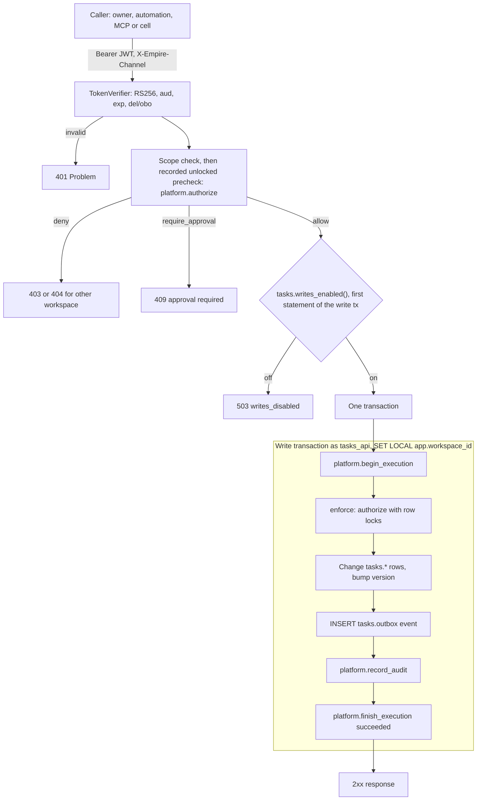
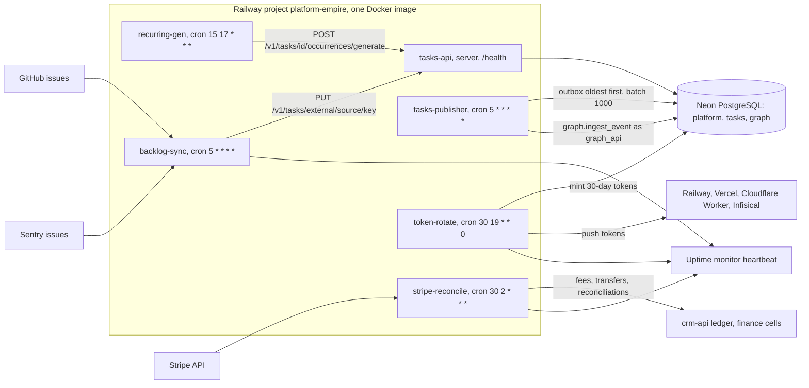
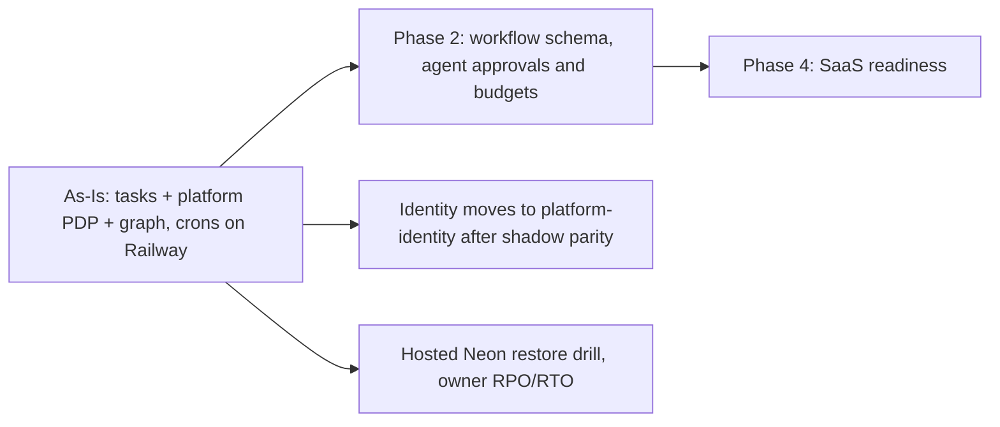

# 01 — Business process (As-Is / To-Be)

repo นี้คือ **empire-platform**: monorepo ของ control plane กลางของ Solo Empire (identity, workspace, delegation, authorization decision point, Tasks API, outbox → Empire Graph) และ cron jobs ที่รันบน image เดียวกันใน Railway project `platform-empire`
ไม่มีหน้า UI ใน repo นี้; หน้าจอ tasks อยู่ที่ `life-dashboard-web` (อ้างใน `PRODUCT.md`)

Last reviewed: 2026-11-27 · commit `3804c90`

## As-Is (จากโค้ดวันนี้)

### A. เส้นทางการเขียนหนึ่งครั้ง (ทุก write ใน tasks cell)

Sources: `services/tasks/tasks_api/app.py` (module docstring, lines ~500–690), `services/tasks/tasks_api/auth.py`, `packages/authz/empire_authz/__init__.py`, `services/platform/migrations/0003_authorization_decision_point.sql`, `services/tasks/migrations/1004_write_switch.sql`

### B. งานตามรอบเวลา (Railway crons) และการไหลของข้อมูล

Sources: `.railway/railway.ts`, `docker-entrypoint.sh`, `services/tasks/tasks_api/publisher.py`, `src/empire_platform/recurring.py`, `src/empire_platform/backlog_sync.py`, `src/empire_platform/stripe_reconcile.py`, `src/empire_platform/hosted_rotate.py`, `contracts/automations/v1/deployments.json`, `README.md`

### C. Cell ที่มีฐานข้อมูลของตัวเอง (decentralized cell)

cell เช่น `solo-decisions` เรียก platform ผ่าน HTTP บน process เดียวกับ tasks-api: `POST /v1/authz/decide` → commit ในฐานข้อมูลของ cell → `POST /v1/executions/{id}/finish` → publisher ของ cell ส่ง `POST /v1/graph/events` ถ้า finish หาย execution ค้าง `running` และ `empire-monitor` รายงาน; owner ปิดด้วย `empire-cells reconcile`
รายละเอียด: [10-sequences.md](10-sequences.md) ภาพที่ 2 และ [docs/runbooks/cell-executions-and-tokens.md](../runbooks/cell-executions-and-tokens.md) (reused)

Sources: `services/platform/platform_api/routes.py`, `src/empire_platform/cells.py`, `services/platform/migrations/0006_cell_executions.sql`, `0007_reconcile_cell_executions.sql`

### D. Catalog และ tenancy บน tasks-api (เพิ่มตั้งแต่ SPEC-002)

`tasks-api` ลงทะเบียน catalog routes (`/v1/catalog/*`: domains, values, metric definitions เป็น node ของ cell `platform` ใน graph) ผ่าน `register_catalog` ใน process เดียวกับ tasks; ตาราง/ฟังก์ชันอยู่ใน `services/graph/migrations/2006_catalog.sql`–`2013`; signup/tenancy ของ platform อยู่ใน `services/platform/migrations/0009_tenancy.sql`–`0011`. ส่วน producer ของ cell อื่น, backfill และ export เข้า lake ยังไม่ยืนยันจากโค้ดใน repo นี้ [ต้องยืนยัน]

Sources: `services/tasks/tasks_api/catalog.py`, `services/tasks/tasks_api/app.py` (`register_catalog`), `services/graph/migrations/2006_catalog.sql`, `services/platform/migrations/0009_tenancy.sql`, `specs/002-catalog-domains-values-metrics/spec.md`

## To-Be (จากเอกสารใน repo และ spec กลางเท่านั้น)

| To-Be item | ที่มา |
|---|---|
| Phase 2 agent execution: `workflow` schema, retry/idempotency, approval, budget และ audit สำหรับ agent 2–3 ตัว | architecture-docs [`docs/superpowers/specs/2026-10-09-platform-foundation-identity-workflow-design.md`](https://github.com/bookchaowalit/architecture-docs/blob/main/docs/superpowers/specs/2026-10-09-platform-foundation-identity-workflow-design.md) §8 |
| Phase 4 SaaS readiness: invite user, tenant isolation ครบ, billing, PDPA | spec เดียวกัน §8 |
| Identity ย้ายไป `platform-identity`: step 3 shadow mirror ของ `/v1/authz/decide` อยู่ในโค้ดแล้ว (`IDENTITY_SHADOW_URL`) ขั้นถัดไปยังไม่มีในโค้ด | `services/platform/platform_api/identity_shadow.py` docstring |
| Hosted restore drill บน Neon isolated branch (ยัง "not yet verified") และ RPO/RTO ที่ owner อนุมัติ | [`docs/runbooks/recovery.md`](../runbooks/recovery.md) |
| Purge archived tasks หลัง 365 วันเป็น job ที่ต้องมี human approval ("does not exist yet") | [`docs/policies/task-deletion.md`](../policies/task-deletion.md) |
| Measures: outbox lag threshold และ backlog health ยังเป็น `[ต้องยืนยัน]`; 5xx/p95 ของ tasks-api | `PRODUCT.md` § Measures |
| Catalog rollout ขั้น 3–5 (producer ของ `life-goals-api`/`life-time-api`, backfill `in-domain`, export รายวันเข้า lake) | `specs/002-catalog-domains-values-metrics/spec.md` Rollout (status accepted 2026-11-22); commit `66aa8a8` เพิ่ม token `catalog-export` แล้ว |
| Promote signing key ใหม่และเอา `TASKS_API_JWT_NEXT_PUBLIC_KEY_PEM` ออกเมื่อ token ทั้งหมดเป็น key ใหม่ | ops record: hosted-shared-services (2026-11-03) |

Sources: เอกสารในตารางด้านบน

## Gap

| ID | As-Is → To-Be | Status | Owner | Evidence |
|---|---|---|---|---|
| G1 | ไม่มี `workflow` schema / agent approval-budget → Phase 2 agent execution | decide | owner | architecture-docs spec 2026-10-09 §8 (status `proposed`); Open questions |
| G2 | tenant isolation/invite ยังไม่ครบ → Phase 4 SaaS readiness | todo | claude | spec 2026-10-09 §8; มี `0009_tenancy.sql`–`0011` เป็นส่วนแรก |
| G3 | `/v1/authz/decide` shadow mirror → identity ย้ายไป `platform-identity` | doing | claude | `services/platform/platform_api/identity_shadow.py` |
| G4 | ยังไม่เคย restore drill บน Neon → drill + RPO/RTO ที่ owner อนุมัติ | decide | owner | `docs/runbooks/recovery.md` ("not yet verified") |
| G5 | ไม่มี job purge archived tasks → purge หลัง 365 วันพร้อม human approval | todo | claude | `docs/policies/task-deletion.md` |
| G6 | catalog routes + migrations 2006–2013 อยู่ในโค้ด → producers, backfill, daily export เข้า lake | doing | claude | `specs/002-catalog-domains-values-metrics/spec.md` Rollout 3–5; commit `66aa8a8` |
| G7 | ยังมี `TASKS_API_JWT_NEXT_PUBLIC_KEY_PEM` → promote key ใหม่แล้วเอาออก | todo | owner | ops record: hosted-shared-services (2026-11-03) |
| G8 | outbox lag / backlog health ยังไม่มี threshold → measures ที่กำหนด | decide | owner | `PRODUCT.md` Measures ([ต้องยืนยัน]) |

## Open questions

- Phase 2 (`workflow` schema) ยังเป็นแผนอยู่หรือถูกแทนด้วย `platform-workflow` repo แล้ว? spec ยังมีสถานะ `proposed`
- ขั้นต่อจาก identity shadow (step 4+) คืออะไร และ tasks-api จะเลิกเป็น PDP ของ cell เมื่อไร (ops record book-platforms-status บอกว่า 8 platform services เชื่อ issuer ของ identity แล้วตั้งแต่ 2026-10-29)
- ไม่มี UPGRADE-PLAN หรือ `specs/` ใน repo นี้; To-Be ข้างบนมาจาก spec กลางและ runbook เท่านั้น
