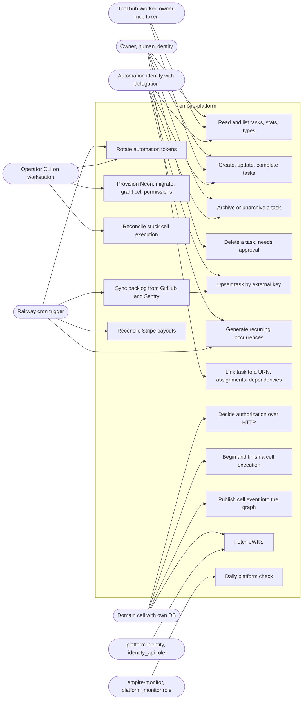

# 02 — Use cases

Actors มาจาก role และระดับ auth ที่โค้ดตรวจจริง: `platform.identities.kind` (`human`, `agent`, `service_account`, `automation`), channel ใน token/header (`api`, `mcp`, `workflow`, `cli`, `event`), audience ของ token (`tasks-api`, `platform-api`, `graph-api`) และ database role ใน `db/bootstrap/roles.sql`

Sources: `services/tasks/tasks_api/app.py` (routes), `services/tasks/tasks_api/auth.py` (`CHANNELS`, `AUDIENCE`), `services/platform/platform_api/routes.py`, `src/empire_platform/jwks.py`, `db/bootstrap/roles.sql`, `services/platform/migrations/0001_platform_core.sql`, `contracts/automations/v1/automations.json`, `docs/policies/task-deletion.md`, `src/empire_platform/{cells,neon,monitor,hosted_rotate,rotate,recurring,backlog_sync,stripe_reconcile}.py`, `PRODUCT.md`

## กติกาที่โค้ดบังคับต่อ actor

| Actor | ได้อะไร | ข้อจำกัดที่เห็นในโค้ด |
|---|---|---|
| Owner (human) | ทุก permission ของ owner role ใน workspace | token ที่ไม่มี delegation อายุไม่เกิน 3600 s (`MAX_LIFETIME_SECONDS`); hard delete ต้องมี approval ตาม policy |
| Automation | เฉพาะ scopes ใน delegation (46 automations ใน `automations.json`) | scopes ต้องเป็น subset ของ grantor ตอนสร้างและตรวจกับสิทธิ์ live ทุกครั้ง; ไม่มี automation ใดถือ `tasks.task:delete` (test บังคับ) |
| Domain cell | `/v1/authz/decide`, `/v1/executions*` ด้วย audience `platform-api`; `/v1/graph/events` ด้วย `graph-api` | publish ได้เฉพาะ namespace ของตัวเอง (`graph.<cell>:write`); cell ส่ง token ของ caller ต่อ ไม่ใช่ token ของ cell |
| MCP issuer `empire-mcp` | `tasks.task:read`, `tasks.task:write`, `tasks.status:write`, `tasks.link:write` | อายุ ≤ 300 s, ห้าม `del`/`obo`, channel `mcp` เท่านั้น (ใช้เมื่อ hosted MCP ถูกเปิด ซึ่งปลดระวางแล้ว 2026-10-18) |
| platform_monitor | อ่าน id, count, version, outbox state, decision code | ไม่เห็นเนื้อหา task (`3001_monitor_role.sql`) |
| identity_api | `platform.authorize` และคอลัมน์ identity/membership แบบอ่าน | ไม่มีสิทธิ์เขียน (`0008_identity_api_role.sql`) |

Sources: `services/tasks/tasks_api/auth.py`, `src/empire_platform/token_exchange.py`, `services/monitor/migrations/3001_monitor_role.sql`, `services/platform/migrations/0008_identity_api_role.sql`, `tests/test_automations.py`, `docs/runbooks/remote-mcp.md`

## Open questions

- ใครสร้างและอนุมัติแถว `platform.approvals`? ไม่มี HTTP route หรือ CLI ที่ INSERT/UPDATE approvals ในโค้ด (มีแค่ใน tests); hard delete ที่ต้องการ approval จึงยังไม่มีทางทำผ่าน API
- `agent` และ `service_account` kind มีใน schema แต่ไม่มี automation ใดในโค้ดที่ระบุ kind เหล่านี้โดยตรง; จะใช้เมื่อไร
