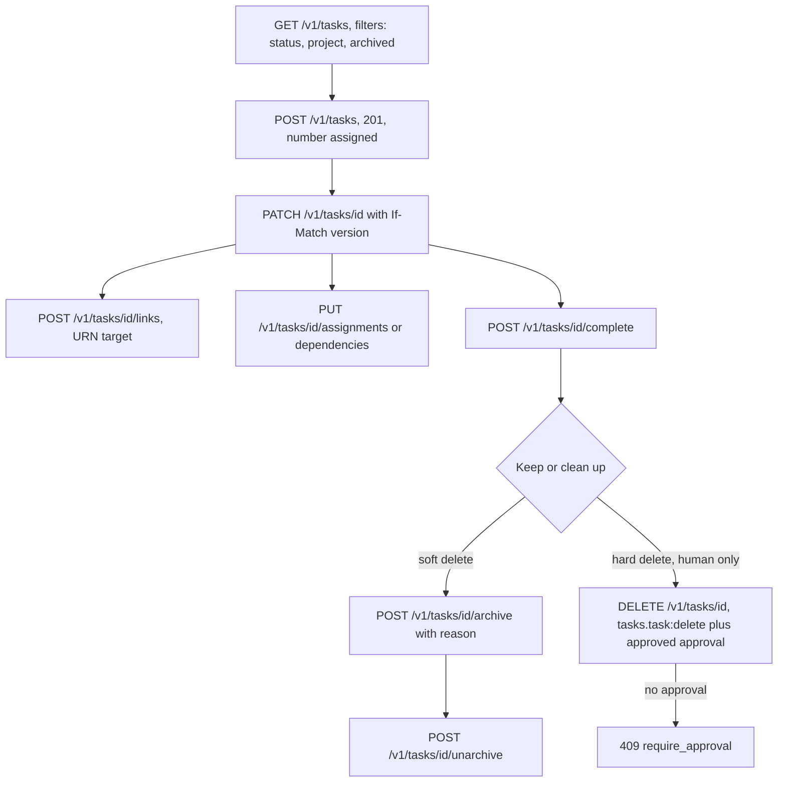
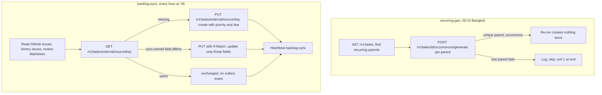
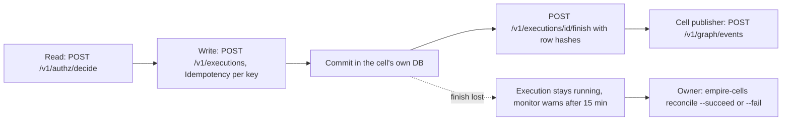
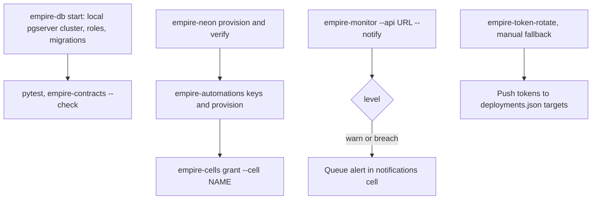

# 03 — User flows per role

repo นี้เป็น API และ jobs ไม่มีหน้าเว็บ; "flow" จึงเป็นลำดับการเรียก route และ CLI ต่อ role (หน้าจอ tasks อยู่ใน `life-dashboard-web` นอก repo)

## 1. Owner: วงจรงานหนึ่งชิ้น (ผ่าน API, local `empire-mcp` หรือ tool hub)

Sources: `services/tasks/tasks_api/app.py` (routes at lines 790–1844), `services/mcp/empire_mcp/server.py` (tools `tasks.list/get/create/update/complete/link`, `graph.search/neighbors`), `docs/policies/task-deletion.md`, `contracts/tasks/v1/openapi.json`

MCP tools ไม่มี delete และ archive (`server.py`; `docs/policies/task-deletion.md` "the new MCP has no delete tool")

## 2. Automation: recurring-gen (daily) และ backlog-sync (hourly)

Sources: `src/empire_platform/recurring.py`, `src/empire_platform/backlog_sync.py`, `docs/runbooks/backlog-sync.md` (reused), `.railway/railway.ts`

## 3. Domain cell ที่มี DB ของตัวเอง

Sources: `services/platform/platform_api/routes.py`, `src/empire_platform/cells.py`, `docs/runbooks/cell-executions-and-tokens.md` (reused)

## 4. Operator (owner workstation)

Sources: `README.md` (Local development, Token rotation), `src/empire_platform/{devdb,neon,automations,cells,monitor,rotate}.py`, `pyproject.toml` `[project.scripts]`

## Open questions

- `empire-monitor` รันที่ไหนวันนี้? runbook บอกว่า crontab ของ owner รันทุกวัน 02:17 (historical, 2026-10-09) แต่ไม่มี Railway service หรือ workflow ของ monitor ใน repo นี้
- ไม่มี flow ของ owner บน UI ใน repo; ต้องอ้างอิง `life-dashboard-web` ถ้าต้องการ screen flow
