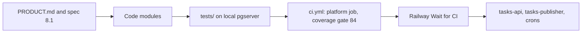

# 04 — Traceability (RTM)

requirement มาจาก `PRODUCT.md` (Capabilities and Constraints, Measures) และ acceptance criteria เฟส 1 ใน spec กลาง ([§8.1](https://github.com/bookchaowalit/architecture-docs/blob/main/docs/superpowers/specs/2026-10-09-platform-foundation-identity-workflow-design.md)); repo ไม่มีโฟลเดอร์ `specs/` ของตัวเอง
Release: ทุกแถวขึ้น production ผ่าน `.github/workflows/ci.yml` (jobs `platform`, `security`) → Railway Wait for CI → service ที่ระบุ

| ID | Requirement | Code module | Test file(s) | Release / service |
|---|---|---|---|---|
| R1 | Authorization denies by default, `resource_not_found` for other workspaces, records every decision | `services/platform/migrations/0003_authorization_decision_point.sql`, `packages/authz/empire_authz/__init__.py` | `tests/test_authz.py`, `contracts/authz/v1/conformance.json` | `tasks-api` |
| R2 | Writes check twice (precheck, then `enforce` with locks) so revocation between is caught | `services/tasks/tasks_api/app.py` (`precheck`, `acting`) | `tests/test_authz.py` (TOCTOU), `tests/test_delegation.py` | `tasks-api` |
| R3 | Workspace A cannot read or change workspace B (API, MCP, DB role) — spec 8.1 #2 | migrations `0002_*`, `1001_*`, `2001_*` (forced RLS) | `tests/test_tenant_isolation.py`, `tests/test_role_cannot_bypass_rls.py`, `tests/test_tasks_api.py`, `tests/test_mcp.py` | `tasks-api` |
| R4 | Agents never exceed the grantor (delegation subset, live re-check) — spec 8.1 #3 | `0002_authorization_and_rls.sql` (`check_delegation`), `src/empire_platform/automations.py` | `tests/test_delegation.py`, `tests/test_automations.py` | `tasks-api`, `token-rotate` |
| R5 | API and MCP use the same authorization code — spec 8.1 #4 | `services/mcp/empire_mcp/server.py` (calls the API with the caller's token) | `tests/test_mcp.py`, `tests/test_mcp_errors.py` | local `empire-mcp` only |
| R6 | Tasks API `tasks.v1`: tasks, relations, occurrences, archive, idempotent upsert by external key | `services/tasks/tasks_api/app.py`, `contracts/tasks/v1/openapi.json` | `tests/test_tasks_api.py`, `tests/test_tasks_relations.py`, `tests/test_tasks_writer_parity.py`, `tests/test_tasks_contract.py`, `tests/test_task_store_contract.py` | `tasks-api` |
| R7 | Every write leaves an execution, outbox event and audit event | `app.py` (`emit`, `record_audit`), `1003_outbox_publisher.sql` | `tests/test_tasks_contract.py`, `tests/test_tasks_api.py` | `tasks-api` |
| R8 | Graph fed by the outbox: at least once, oldest first, retry with backoff, idempotent consumer | `services/tasks/tasks_api/publisher.py`, `services/graph/graph_service/consumer.py`, `2005_ingest_version_guard.sql` | `tests/test_graph.py` | `tasks-publisher` |
| R9 | Cells with own DB: decide, executions, graph events over HTTP | `services/platform/platform_api/routes.py` | `tests/test_platform_http.py`, `tests/test_cells_reconcile.py` | `tasks-api` |
| R10 | No automation token outlives its rotation window (30-day tokens, weekly rotate, 10-day window) | `src/empire_platform/hosted_rotate.py`, `rotate.py`, `contracts/automations/v1/deployments.json` | `tests/test_hosted_rotate.py`, `tests/test_rotate.py` | `token-rotate` |
| R11 | Recurring occurrences generated daily, idempotent | `src/empire_platform/recurring.py` | `tests/test_recurring.py` | `recurring-gen` |
| R12 | Single backlog from GitHub, Sentry, reviews (owner D2) | `src/empire_platform/backlog_sync.py` | `tests/test_backlog_sync.py` | `backlog-sync` |
| R13 | Stripe fees and payouts reconciled (EOS G2) | `src/empire_platform/stripe_reconcile.py` | `tests/test_stripe_reconcile.py` | `stripe-reconcile` |
| R14 | Errors go to Sentry without personal data or secrets — spec 8.1 #7 | `src/empire_platform/_sentry.py` | `tests/test_sentry.py` | all services |
| R15 | Monitor: outbox lag, lost tasks, stuck executions, token expiry | `src/empire_platform/monitor.py`, `services/monitor/migrations/*` | `tests/test_monitor.py`, `tests/test_monitor_notify.py` | not a Railway service (see 20) |
| R16 | Backup and restore rehearsed — spec 8.1 #6 | `tests/test_recovery_rehearsal.py`, `docs/runbooks/recovery.md` | `tests/test_recovery_rehearsal.py` | local drill only; hosted drill not verified |
| R17 | Published JWK Set verifies exactly platform-signed tokens | `src/empire_platform/jwks.py` | `tests/test_jwks.py` | `tasks-api` `/.well-known/jwks.json` |
| R18 | Platform service audiences and shared scopes | `src/empire_platform/automations.py`, `permissions.py` | `tests/test_platform_audiences.py`, `tests/test_platform_permissions.py` | `token-rotate` (minting) |
| R19 | Identity shadow parity (platform-identity step 3) | `services/platform/platform_api/identity_shadow.py`, `0008_identity_api_role.sql` | `tests/test_identity_shadow.py` | `tasks-api` when `IDENTITY_SHADOW_URL` set |
| R20 | Migrations apply once, checksum-verified | `src/empire_platform/devdb.py` | `tests/test_migrations.py` | applied by operator (`empire-neon`), not by deploy |

Sources: ตารางด้านบน, `.github/workflows/ci.yml`, `.railway/railway.ts`

## Gaps

- R15 และ R16 ไม่มี production release path ใน repo (monitor ไม่มี service, restore drill hosted ยังไม่ verified)
- Measure "Writes in cells without a matching authorization decision and audit event (target 0)" ใน `PRODUCT.md` ไม่มีโค้ดหรือ test ที่วัดค่านี้
- Measure "Open tasks with no update in 30 days" ยังเป็น `[ต้องยืนยัน]` และไม่มีโค้ด
- spec 8.1 #1 (writers 39 ไฟล์ไม่เขียน SQLite ตรง) และ #5 (migration field-level check) เป็นงาน historical; importer และ rehearsal script ถูกลบหลัง cutover (`docs/runbooks/tasks-cutover-and-rollback.md`)

## Open questions

- migration บน production ถูก apply อย่างไรหลัง deploy? ไม่มี step ใน Dockerfile/entrypoint ที่รัน migrate; ดูเหมือนเป็นงาน operator ผ่าน `empire-neon` (ยืนยันกับ owner)
