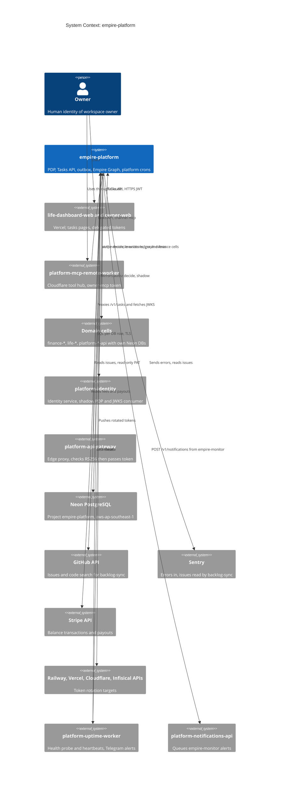

# 05 — C4 Context

Sources: `PRODUCT.md` (Users, Operating Context), `services/platform/platform_api/routes.py`, `services/platform/platform_api/identity_shadow.py`, `src/empire_platform/backlog_sync.py` (`GITHUB_API`, `SENTRY_API`), `src/empire_platform/stripe_reconcile.py`, `src/empire_platform/hosted_rotate.py` (provider APIs), `src/empire_platform/monitor.py` (`notify`), `src/empire_platform/_sentry.py`, `contracts/automations/v1/deployments.json`, `docs/runbooks/tasks-cutover-and-rollback.md` (Neon region), ops record: api-gateway-edge (2026-11-03)

ภาพรวม C4 ระดับ workspace ทั้งหมดอยู่ที่ architecture-docs [`docs/architecture/C4-DIAGRAMS.md`](https://github.com/bookchaowalit/architecture-docs/blob/main/docs/architecture/C4-DIAGRAMS.md) (reused, ระดับกว้างกว่า)

## Open questions

- ผู้บริโภคปัจจุบันของ Tasks API ครบหรือยัง (เช่น Go `task-sync`, TypeScript writers ที่ runbook ระบุว่า "still pending")? รายชื่อ automation ใน `automations.json` มี 46 ตัว แต่ไม่ได้บอกว่าตัวไหนยัง active
