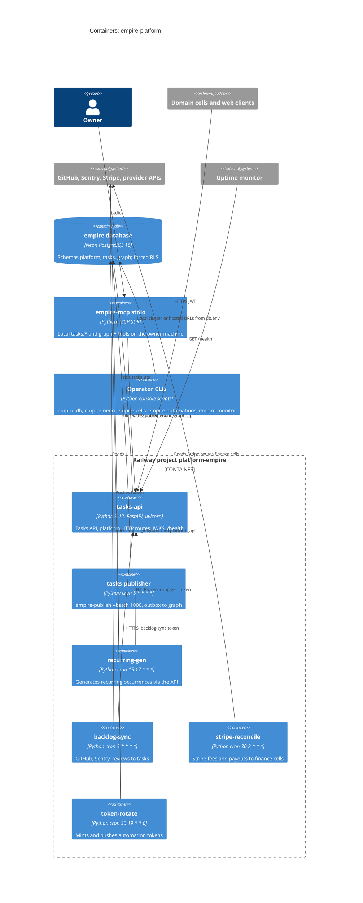

# 06 — C4 Container

ทุก container ใน Railway build จาก `Dockerfile` เดียวกัน และเลือก process ด้วย `EMPIRE_SERVICE` หรือ `startCommand` ใน `.railway/railway.ts`

Sources: `.railway/railway.ts`, `Dockerfile`, `docker-entrypoint.sh`, `pyproject.toml` (`[project.scripts]`, dependencies), `services/tasks/tasks_api/app.py` (`main`), `services/tasks/tasks_api/publisher.py` (`main`), `services/mcp/empire_mcp/server.py`, `src/empire_platform/hosted_rotate.py` (environment: `EMPIRE_DB_URL_EMPIRE_MIGRATOR`, `EMPIRE_DB_URL_PLATFORM_API`), `db/bootstrap/roles.sql`, `docs/runbooks/tasks-cutover-and-rollback.md`

## หมายเหตุ

- Graph read API (`services/graph/graph_service/app.py`: `/v1/graph/neighbors`, `/v1/graph/search`, `/v1/graph/consents`) มี `create_app` แต่ **ไม่มี console script หรือ Railway service** ที่ serve มัน; ใน production มีแค่ consumer (ใน publisher) และ `POST /v1/graph/events` (ใน tasks-api)
- `empire-mcp-http` (hosted MCP, Clerk OAuth) ปลดระวาง 2026-10-18 ไม่เคย deploy (`docs/runbooks/remote-mcp.md`); โค้ดยังอยู่
- โฟลเดอร์ `build/lib/` เป็นสำเนา build เก่าที่ commit ไว้ (ไม่มี `backlog_sync.py`, ไฟล์อื่นต่างจาก `src/`); Dockerfile ไม่ COPY มัน

## Open questions

- ควรลบ `build/lib/` ออกจาก git หรือไม่ (mypy exclude ไว้แล้ว `exclude = ["^build/"]`)
- Graph read API จะ deploy เมื่อไร หรือ local `empire-mcp` ชี้ `EMPIRE_GRAPH_API` (default `http://127.0.0.1:3602`) ไปที่ใด
