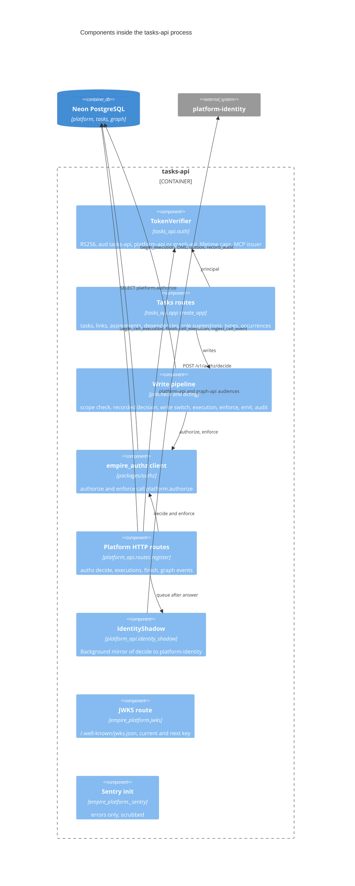
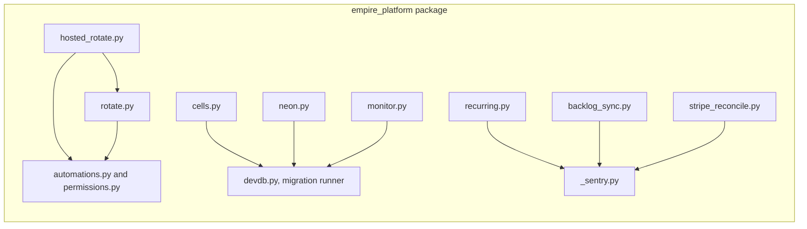

# 07 — C4 Component (tasks-api process)

Sources: `services/tasks/tasks_api/app.py`, `services/tasks/tasks_api/auth.py`, `packages/authz/empire_authz/__init__.py`, `services/platform/platform_api/routes.py`, `services/platform/platform_api/identity_shadow.py`, `src/empire_platform/jwks.py`, `src/empire_platform/_sentry.py`, `src/empire_platform/__init__.py`, migrations `0006_cell_executions.sql`, `2004_cell_ingest.sql`

## Components ของ jobs (`src/empire_platform/`)

Sources: imports ใน `src/empire_platform/hosted_rotate.py` (`from empire_platform.rotate import ...`), `rotate.py`, `cells.py`, `neon.py`, `monitor.py`, `recurring.py`, `backlog_sync.py`, `stripe_reconcile.py`

## Open questions

- ไม่มี
