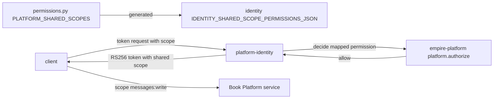

# ADR-0007 — empire-platform owns the shared-scope → canonical permission map that platform-identity mints from

- Status: **accepted (retro-documented)** 2026-11-04, from code on `main` `51c8ad3`
- Date: decision recorded in commit `00bf27a` (2026-10-29); extended by `5e87e0a`, `c5538d3`, `d14cbef` (2026-11-03), `16b5349` (2026-11-04)

## Context

Book Platform services (communication, media, data, workflow, commerce, logistics, developer, then security, payment, ai) ตรวจ scope แบบสั้น เช่น `messages:write` ส่วน PDP ของ empire-platform (`platform.authorize`, ADR-0002) ตัดสินจาก canonical permission แบบ `communication.message:write` ต้องมีที่เดียวที่ผูกสองชื่อนี้เข้าด้วยกัน เพื่อไม่ให้ issuer ออก scope ที่ PDP ไม่เคยอนุญาต

commit `00bf27a` บันทึกว่า owner เลือก platform-identity เป็น issuer ของ platform services (2026-10-29)

## Decision

- `PLATFORM_SHARED_SCOPES` ใน `src/empire_platform/permissions.py` เป็น map เดียวจาก shared scope → canonical permission
- platform-identity mint shared scope ให้ก็ต่อเมื่อ `platform.authorize` อนุญาต permission ที่ map ไว้; ค่า `IDENTITY_SHARED_SCOPE_PERMISSIONS_JSON` ของ identity สร้างจาก map นี้ (comment ใน `permissions.py`)
- owner permission ของแต่ละ service (`CELL_OWNERS[<service>]`) คำนวณจาก prefix ของ map จึง grant ได้ด้วย `empire-cells grant`
- service ใหม่เพิ่มเป็น audience ใน `devtoken.py` `DEFAULT_AUDIENCES` + scopes ใน map + test (`test_platform_audiences.py`, `test_platform_permissions.py`) ใน commit เดียว

## Evidence

- `src/empire_platform/permissions.py` (`PLATFORM_SHARED_SCOPES`, loop ที่สร้าง `CELL_OWNERS`)
- `src/empire_platform/devtoken.py` (`DEFAULT_AUDIENCES`: `security-api`, `payment-api`, `ai-api`)
- `tests/test_platform_permissions.py`, `tests/test_platform_audiences.py`
- `git log -- src/empire_platform/permissions.py`: `00bf27a`, `5e87e0a`, `c5538d3`, `d14cbef`, `16b5349`

## Consequences

- การเพิ่ม scope ต้องทำสองที่: merge ที่ repo นี้ แล้ว regenerate JSON ที่ identity; ถ้าลืมขั้นที่สอง identity จะไม่ mint scope ใหม่ (fail closed)
- ไม่มี test ข้าม repo ที่ยืนยันว่า JSON ของ identity ตรงกับ map ปัจจุบัน (drift ตรวจไม่ได้อัตโนมัติ)
- empire-platform เป็น dependency ของ token issuance ทุก platform service: PDP ล่ม = mint token ใหม่ไม่ได้ (token เดิมใช้ได้จนหมดอายุ)

## Open questions

- ขั้น regenerate `IDENTITY_SHARED_SCOPE_PERMISSIONS_JSON` ทำด้วย script ใดและใครรัน (ไม่มีใน repo นี้)
- `ai:read` / `ai:generate` (commit `16b5349`) อ้าง "owner decision 2026-11-04: platform-ai-gateway-api is the ai service" แต่ brief ฝั่ง portfolio ยังถือว่าการตัดสินใจ ai platform เปิดอยู่: owner ยืนยัน

Sources: `src/empire_platform/permissions.py`, `src/empire_platform/devtoken.py`, `tests/test_platform_permissions.py`, `tests/test_platform_audiences.py`, `git show 00bf27a 16b5349`
