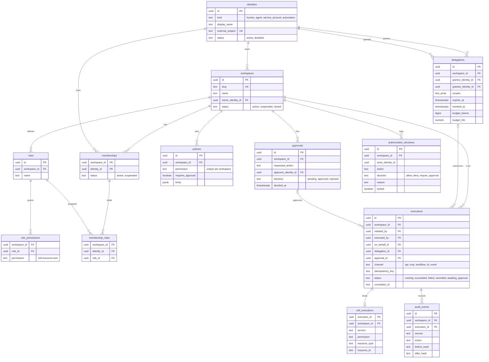
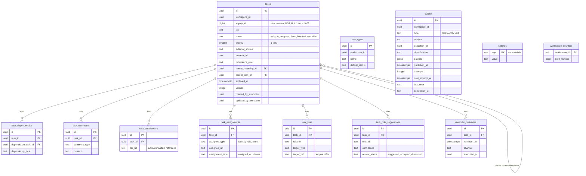
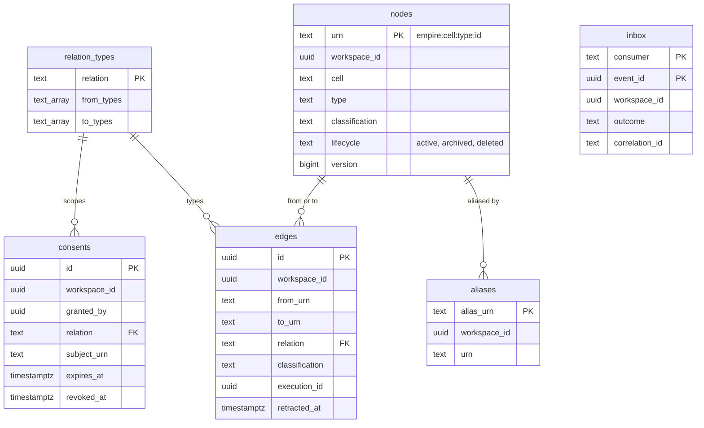

# 09 — ERD

ข้อมูลถาวรทั้งหมดอยู่ใน PostgreSQL database `empire` (Neon project `empire-platform`) สาม schema; ทุกตารางที่มี `workspace_id` มี forced RLS ภาพนี้แสดงคอลัมน์หลัก (ไม่ใช่ทุกคอลัมน์) จาก `CREATE TABLE` และ `ALTER TABLE ... ADD COLUMN`

## Schema `platform`

Sources: `services/platform/migrations/0001_platform_core.sql`, `0003_authorization_decision_point.sql`, `0005_correlation.sql`, `0006_cell_executions.sql`

## Schema `tasks`

Sources: `services/tasks/migrations/1001_tasks_core.sql`, `1002_writer_parity.sql`, `1004_write_switch.sql`, `1005_numbers_and_correlation.sql`

`tasks.*.workspace_id` และ `execution_id` ไม่มี FK ข้าม schema ไปที่ `platform` (อ้างด้วยค่าและ RLS เท่านั้น); FK ภายใน `tasks` เป็นแบบ composite `(workspace_id, id)`

## Schema `graph`

Sources: `services/graph/migrations/2001_graph_core.sql`, `2002_correlation.sql`

ความสัมพันธ์ `nodes → aliases / edges` เป็นการอ้างด้วยค่า URN (ไม่มี FK ใน DDL) ภาพแสดงตามการใช้งานใน `graph.resolve`, `graph.neighbors`

ERD ระดับ workspace: architecture-docs [`docs/architecture/ERD-DIAGRAMS.md`](https://github.com/bookchaowalit/architecture-docs/blob/main/docs/architecture/ERD-DIAGRAMS.md) (reused, กว้างกว่า)

## Open questions

- `delegations.budget_tokens` / `budget_thb` และ `policies.limits` มีใน schema แต่ไม่พบโค้ดที่บังคับ budget หรือ limits; จะใช้ใน Phase 2 หรือไม่
