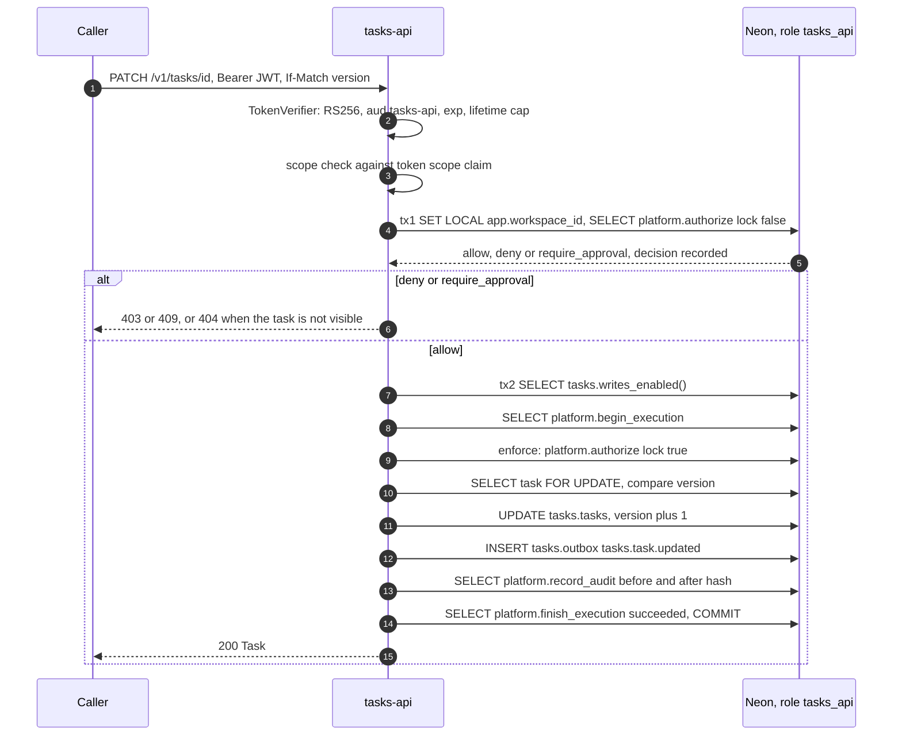
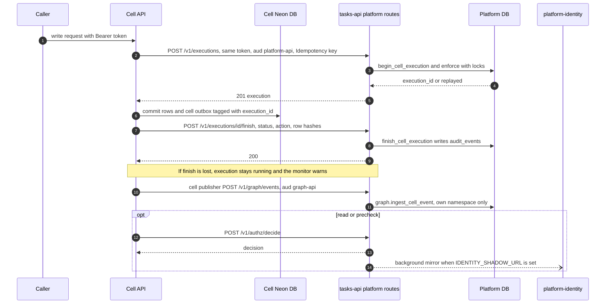
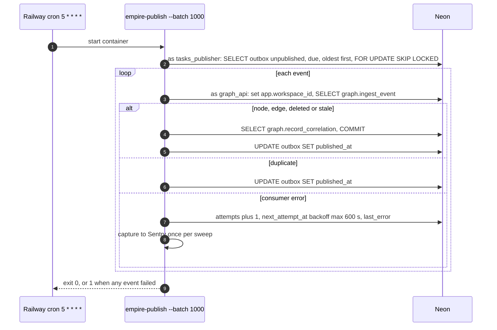
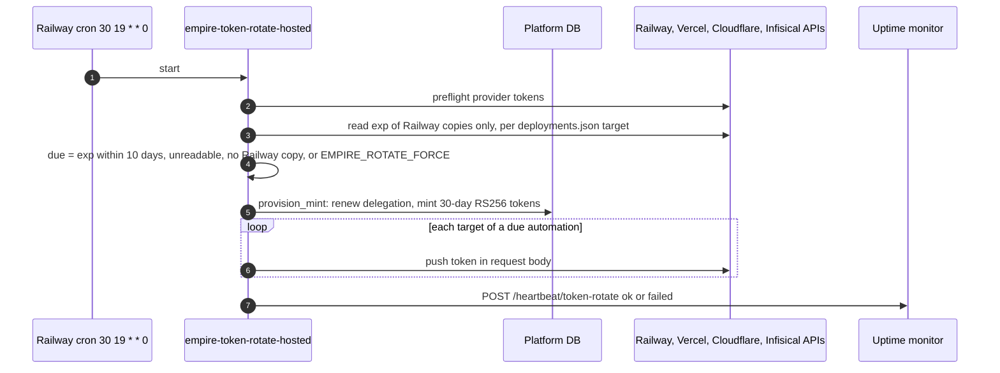

# 10 — Sequence diagrams

## 1. Owner หรือ automation แก้ task (`PATCH /v1/tasks/{id}`)

Sources: `services/tasks/tasks_api/app.py` (`principal`, `precheck`, `acting`, `emit`, PATCH route line 1003), `services/tasks/tasks_api/auth.py`, `packages/authz/empire_authz/__init__.py`, `services/platform/migrations/0003_authorization_decision_point.sql`

## 2. Cell ที่มี DB ของตัวเองเขียนข้อมูล (เช่น solo-decisions)

Sources: `services/platform/platform_api/routes.py`, `services/platform/platform_api/identity_shadow.py`, `services/platform/migrations/0006_cell_executions.sql`, `services/graph/migrations/2004_cell_ingest.sql`, `docs/runbooks/cell-executions-and-tokens.md`

## 3. Outbox → Empire Graph (cron ทุกชั่วโมง)

Sources: `services/tasks/tasks_api/publisher.py`, `services/graph/graph_service/consumer.py`, `services/graph/migrations/2005_ingest_version_guard.sql`, `.railway/railway.ts`

## 4. Weekly token rotation (`token-rotate`)

Sources: `src/empire_platform/hosted_rotate.py` (docstring, `push`, `provision_mint`, `heartbeat`), `src/empire_platform/rotate.py`, `contracts/automations/v1/deployments.json`, `tests/test_hosted_rotate.py`

หมายเหตุข้อ 4: อ่าน exp ได้เฉพาะสำเนาบน Railway (`due_hosted`); automation ที่ไม่มีสำเนาบน Railway (เช่น `owner-mcp` บน Cloudflare + Infisical, `solo-web` บน Vercel) ถูก rotate ทุกรอบ

## Open questions

- ไม่มี
