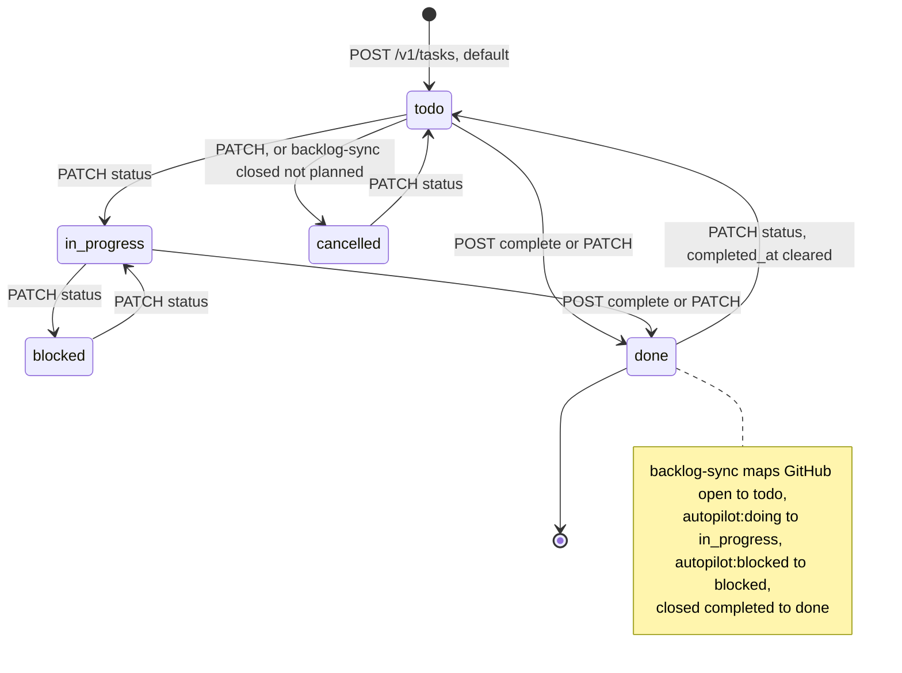
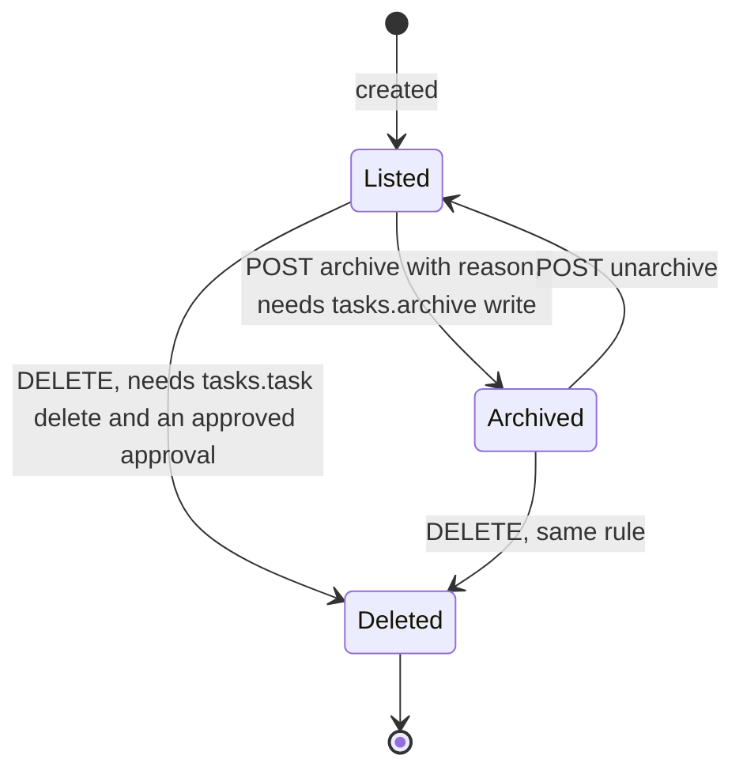
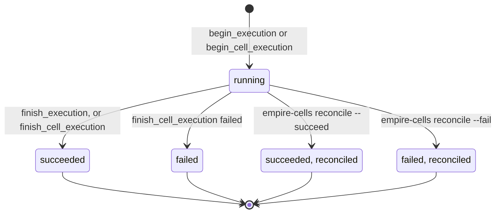
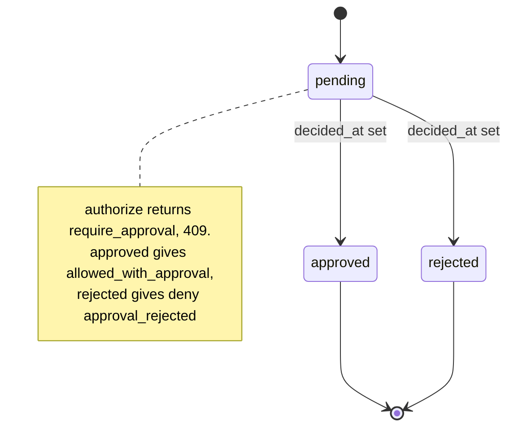
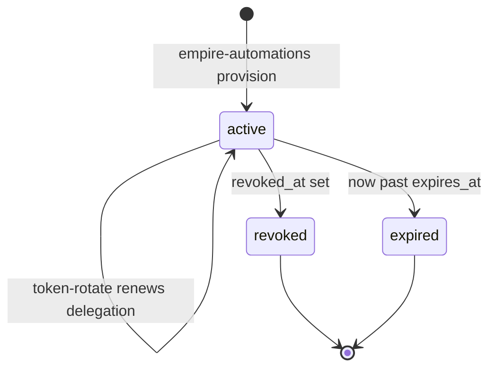
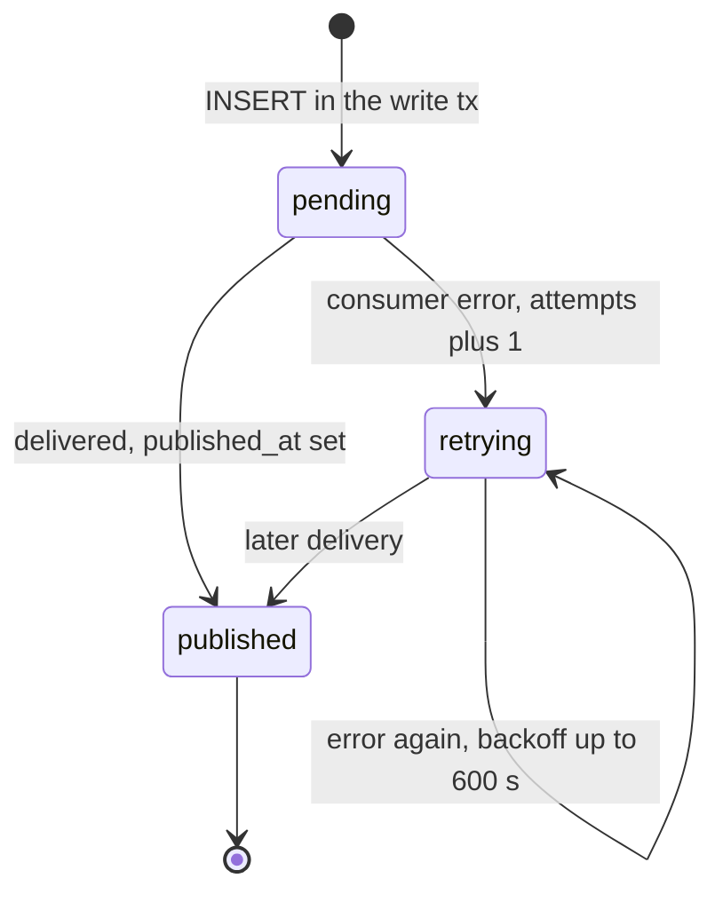
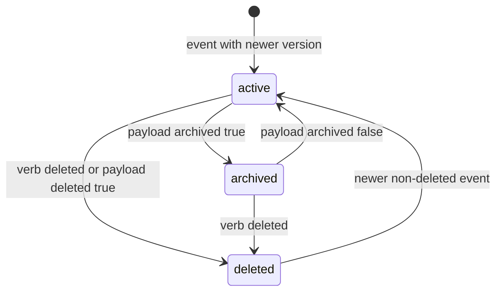

# 11 — State machines

## 1. `tasks.tasks.status` (+ archive)

API ไม่บังคับลำดับ transition: `PATCH /v1/tasks/{id}` ตั้ง `status` ใดก็ได้จาก 5 ค่า; กฎที่โค้ดบังคับมีแค่ `done ⇒ completed_at` (CHECK) และออกจาก `done` แล้ว `completed_at` ถูกล้าง ภาพแสดง transition ที่ route และ job ทำจริง

Sources: `services/tasks/migrations/1001_tasks_core.sql` (CHECK on status, `completed_at`), `services/tasks/tasks_api/app.py` (lines 929, 1030, 1060, 1255, 1285, 1308), `docs/runbooks/backlog-sync.md`, `docs/policies/task-deletion.md`

## 2. `platform.executions.status`

`cancelled` และ `awaiting_approval` อยู่ใน CHECK แต่ไม่มีโค้ดที่ตั้งค่าเหล่านี้ (tasks-api rollback ทั้ง transaction เมื่อ deny จึงไม่มี execution ค้าง)

Sources: `services/platform/migrations/0001_platform_core.sql`, `0003_authorization_decision_point.sql`, `0006_cell_executions.sql`, `0007_reconcile_cell_executions.sql`, `services/tasks/tasks_api/app.py` line 647, `src/empire_platform/cells.py`

## 3. `platform.approvals.decision` และผลต่อ authorize

Sources: `services/platform/migrations/0001_platform_core.sql` (CHECK `(decision = 'pending') = (decided_at IS NULL)`), `0003_authorization_decision_point.sql`

## 4. Delegation (derived from `expires_at`, `revoked_at`)

Sources: `services/platform/migrations/0001_platform_core.sql`, `0002_authorization_and_rls.sql` (`check_delegation`), `src/empire_platform/automations.py`, PR #3 "renew delegations", `docs/runbooks/cell-executions-and-tokens.md`

## 5. Outbox event

Sources: `services/tasks/tasks_api/publisher.py`, `services/tasks/migrations/1002_writer_parity.sql`

## 6. Graph node `lifecycle` และผล ingest

ทุก event ที่ version เก่ากว่าได้ outcome `stale`; event ซ้ำได้ `duplicate` (inbox)

Sources: `services/graph/migrations/2001_graph_core.sql`, `2005_ingest_version_guard.sql`

## 7. Identity, workspace, membership

| Entity | ค่าใน CHECK | ผลใน authorize |
|---|---|---|
| `identities.status` | `active`, `disabled` | ต้อง `active` |
| `workspaces.status` | `active`, `suspended`, `closed` | ต้อง `active` |
| `memberships.status` | `active`, `suspended` | ต้อง `active` |

ไม่มี route ที่เปลี่ยนค่าเหล่านี้; `platform_api` มี `GRANT UPDATE (display_name, status)` บน identities

Sources: `services/platform/migrations/0001_platform_core.sql`, `0002_authorization_and_rls.sql` (lines 18–21, 168)

## Open questions

- ต้องการให้ Tasks API บังคับลำดับ status (เช่นห้าม `cancelled → done`) หรือไม่
- ข้อ 6 `deleted → active`: version guard ยอมให้ event ใหม่กว่าที่ไม่ใช่ delete สร้าง node กลับ (`deleted_at = NULL` ใน upsert) — เป็นพฤติกรรมที่ตั้งใจหรือไม่
