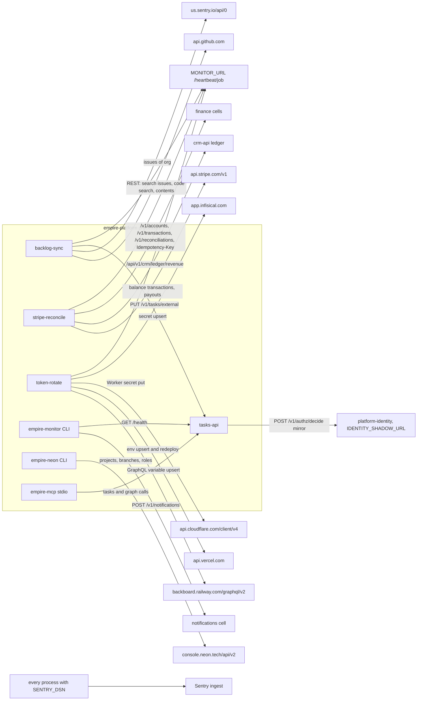

# 12 — API and integrations

Contract ของ Tasks API: [`contracts/tasks/v1/openapi.json`](../../contracts/tasks/v1/openapi.json) (reused; ตรวจโดย `empire-contracts --check` และ `tests/test_tasks_contract.py`); event schema: `contracts/tasks/v1/event.schema.json`; authz: `contracts/authz/v1/`

## Endpoints ที่ serve ใน production (`tasks-api`)

| Group | Method + path | Audience / permission |
|---|---|---|
| Health | `GET /health` | none |
| JWKS | `GET /.well-known/jwks.json` | none |
| Tasks read | `GET /v1/tasks`, `/v1/tasks/stats`, `/v1/tasks/number/{number}`, `/v1/tasks/external/{source}/{external_id:path}`, `/v1/tasks/{id}` | `tasks-api`, `tasks.task:read` |
| Tasks write | `POST /v1/tasks`, `PATCH /v1/tasks/{id}`, `POST /v1/tasks/{id}/complete`, `PUT /v1/tasks/external/{source}/{external_id:path}`, `PUT /v1/tasks/{id}/external-identity` | `tasks.task:write`, `tasks.status:write` |
| Archive / delete | `POST /v1/tasks/{id}/archive`, `/unarchive`, `DELETE /v1/tasks/{id}` | `tasks.archive:write`; `tasks.task:delete` + approval |
| Relations | `POST`/`DELETE /v1/tasks/{id}/links`, `GET /v1/task-links`, `GET /v1/task-assignments`, `PUT /v1/tasks/{id}/assignments`, `GET /v1/task-dependencies`, `PUT /v1/tasks/{id}/dependencies`, `GET`/`PUT`/`PATCH`/`DELETE` role suggestions, `GET /v1/task-types` | per-route `tasks.*` |
| Workers | `POST /v1/tasks/{id}/reminders/delivered`, `POST /v1/tasks/{id}/occurrences/generate` | `tasks.reminder:write`, `tasks.occurrence:write` |
| Platform for cells | `POST /v1/authz/decide`, `POST /v1/executions`, `POST /v1/executions/{id}/finish` | `platform-api` |
| Graph ingest | `POST /v1/graph/events` | `graph-api`, `graph.<cell>:write` |

ไม่ serve ใน production: Graph read API (`GET /v1/graph/neighbors`, `GET /v1/graph/search`, `POST /v1/graph/consents` ใน `graph_service/app.py`) และ hosted MCP (`/mcp`, `/.well-known/oauth-protected-resource/mcp` ใน `empire_mcp/hosted.py`, retired)

Sources: `services/tasks/tasks_api/app.py`, `services/platform/platform_api/routes.py`, `src/empire_platform/jwks.py`, `services/graph/graph_service/app.py`, `services/mcp/empire_mcp/hosted.py`, `docs/runbooks/remote-mcp.md`

## External integrations (outbound)

Sources: `src/empire_platform/backlog_sync.py` (`GITHUB_API`, `SENTRY_API`), `src/empire_platform/stripe_reconcile.py` (`STRIPE_API`, ledger paths), `src/empire_platform/hosted_rotate.py` (`RAILWAY_GRAPHQL`, `VERCEL_API`, `CLOUDFLARE_API`, `INFISICAL_API`), `src/empire_platform/monitor.py` (`notify`), `src/empire_platform/neon.py` (`API`), `services/platform/platform_api/identity_shadow.py`, `services/mcp/empire_mcp/server.py`, `src/empire_platform/_sentry.py`, `docs/runbooks/stripe-reconcile.md`

## Inbound callers ที่รู้จัก

| Caller | ผ่านอะไร | แหล่ง |
|---|---|---|
| Domain cells (`life-*`, `finance-*`, `platform-*-api`) | `/v1/authz/decide`, `/v1/executions*`, `/v1/graph/events`, JWKS | `routes.py` docstring, `deployments.json` (Railway targets ของ life cells) |
| `life-dashboard-web` / owner-web, `accounts-web` (Vercel) | Tasks API ด้วย automation `solo-web`, `accounts-web` | `deployments.json` |
| Tool hub `solo-empire-mcp-remote` (Cloudflare) | Tasks API ด้วย `owner-mcp` | `deployments.json`, `docs/runbooks/remote-mcp.md` |
| Evening check-in Worker `solo-empire-checkin` | token `evening-checkin` (เขียน cell อื่น ไม่ใช่ tasks) | `deployments.json` |
| `gateway.bookchaowalit.com/v1/empire-platform/...` | proxy ไป tasks-api, ตรวจ RS256 ด้วย JWKS นี้ | ops record: api-gateway-edge (2026-11-03) |
| Uptime monitor | `GET /health` | `PRODUCT.md` |

## Open questions

- `X-Correlation-Id` ถูกส่งต่อระหว่าง cell → platform อย่างสม่ำเสมอหรือไม่ (tasks-api รับและเก็บใน execution/outbox แต่ไม่พบ contract ข้าม cell ใน repo)
- ทาง gateway กับทางตรง (`tasks-api-production-4785.up.railway.app`) ใช้คู่กัน: จะปิดทางตรงเมื่อไร
