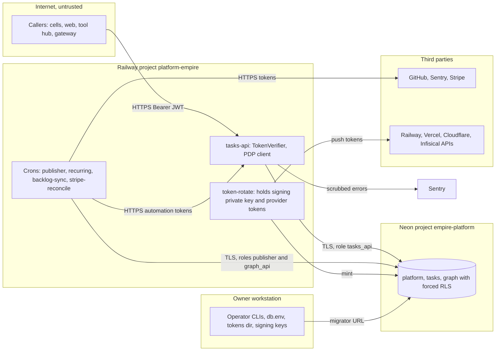

# 13 — Threat model (DFD + STRIDE)

Sources: `.railway/railway.ts`, `db/bootstrap/roles.sql`, `services/tasks/tasks_api/auth.py`, `src/empire_platform/hosted_rotate.py`, `src/empire_platform/_sentry.py`, `src/empire_platform/neon.py`, `docs/runbooks/cell-executions-and-tokens.md`

## STRIDE per element

| Element | Threat | Mitigation found in code | Gap |
|---|---|---|---|
| tasks-api (S) | forged or replayed token | RS256 with pinned PEM(s); `aud` per surface; required `exp iat sub jti`; owner token ≤ 3600 s, delegated ≤ 30 d hard cap; hosted refuses dev issuer and dev key (`auth.py`, `server_config`) | ไม่มี jti replay store; token ไม่มี `kid` (gateway ต้องลองทุก key, ops record api-gateway-edge) |
| tasks-api (T) | lost update | `If-Match` version, `FOR UPDATE`, version bump (`app.py`) | If-Match เป็น optional |
| tasks-api (R) | actor denies an action | every decision in `authorization_decisions`; execution records initiated_by, executed_by, on_behalf_of, delegation, approval, channel; append-only `audit_events` | reconciliation record ไม่ระบุว่าใครรัน (`cell-executions-and-tokens.md`) |
| tasks-api (I) | cross-workspace read | forced RLS + `SET LOCAL app.workspace_id`; other workspace → 404; Sentry sends no locals, bodies, headers, URLs | — |
| tasks-api (D) | DB exhausted or Neon quota | connect error → 503 fast (`bound`); publisher hourly to let compute suspend | ไม่มี rate limit ใน app; edge rate limit อยู่ที่ gateway เท่านั้น (ops record api-gateway-edge); quota หมดทำทุก cell ล่ม (ops record neon-platform-quota) |
| tasks-api (E) | agent escalates beyond grantor | delegation scopes ⊆ grantor live permissions (`check_delegation` trigger); scope claim only narrows; no automation has `tasks.task:delete` (test) | approvals ไม่มี API สร้าง (02 Open questions) |
| Platform HTTP routes (S/E) | cell publishes into another cell's namespace | `graph.<cell>:write` where cell = first segment of event type; action must be in bound service namespace (`0006`) | cross-DB write ไม่ atomic |
| Neon DB (E) | runtime role disables RLS | roles `NOSUPERUSER NOBYPASSRLS NOINHERIT`, own nothing; `empire-neon verify` (`tests/test_role_cannot_bypass_rls.py`) | — |
| Neon DB (T/R) | audit rewrite | `platform.reject_audit_change` trigger, append-only for owner too | — |
| token-rotate (I) | signing key or provider token leak | values on stdin or request body only, JSON lines without secrets (`hosted_rotate.py`) | key อยู่ใน Railway variable; เคยหลุดผ่าน `railway variables --kv` 2026-10-28 (ops record: infisical-list-names-safely); Railway token เป็น workspace-wide (central ADR-0003 risk table) |
| Crons to third parties (I) | private titles leak to public logs | runs on Railway, not public Actions (central ADR-0006); Sentry tasks carry exception type and cleaned location only | — |
| backlog-sync (S/T) | outsider edits issue to inject tasks | only owner, member, collaborator, or `github-actions[bot]` in listed repos (`backlog_sync.py`, PR `9a33ea7`) | — |
| Operator workstation (I) | db.env / tokens readable | token files readable by group/others refused; keys 0600 in 0700 dir (`tasks-cutover-and-rollback.md`) | ไม่มีการตรวจอัตโนมัติบน workstation |
| CI / supply chain (T) | dependency or secret in repo | `security.yml`: gitleaks, semgrep, osv-scanner, trivy-fs; actions SHA-pinned; `uv sync --frozen`; Renovate | — |
| MCP issuer (S) | leaked MCP key acts as anyone | narrow scopes, ≤ 300 s, channel `mcp`, optional `TASKS_API_MCP_SUBJECTS` allowlist (`auth.py`, `remote-mcp.md`) | hosted MCP retired; trust off unless PEM set |

Sources: ไฟล์ในคอลัมน์ mitigation, `.github/workflows/ci.yml`, platform-ci-workflows `security.yml` @ `87dc5e1c`, `renovate.json`, `Dockerfile`, architecture-docs [ATTACK-PATH-DIAGRAMS.md](https://github.com/bookchaowalit/architecture-docs/blob/main/docs/architecture/ATTACK-PATH-DIAGRAMS.md) (ระดับ workspace, reused)

## Open questions

- ต้องการ jti replay protection หรือ revocation list สำหรับ token ที่ยังไม่หมดอายุหรือไม่ (ตอนนี้ revoke ได้ผ่าน delegation เท่านั้น)
- การ rotate issuer signing key หลังเหตุ 2026-10-28 ทำแล้วหรือยัง (owner decision)
