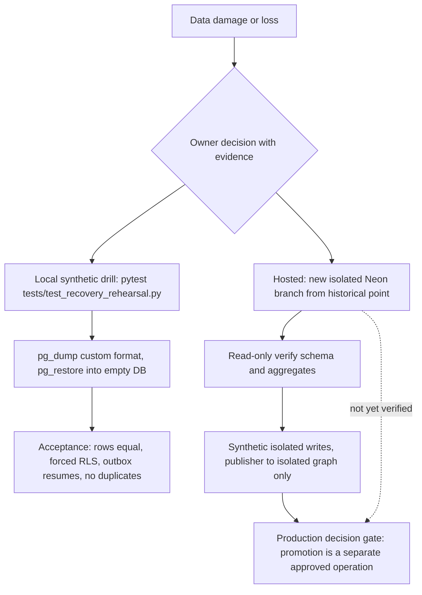

# 14 — Backup and DR

Runbook หลัก (reused): [`docs/runbooks/recovery.md`](../runbooks/recovery.md); ประวัติ cutover: [`docs/runbooks/tasks-cutover-and-rollback.md`](../runbooks/tasks-cutover-and-rollback.md)

## ข้อมูลที่มีและที่อยู่

| Data | Where | Backup / restore reality |
|---|---|---|
| `platform`, `tasks`, `graph` schemas | Neon project `empire-platform`, database `empire`, aws-ap-southeast-1, PG 16 | Neon provider history/branching ("Retention/PIT window: Unknown; no current Neon plan/window was checked" — recovery.md); snapshot branch `cutover-after-import-*` จาก 2026-10-09 "present availability is unverified" |
| Same, local dev | `.runtime/pgdata` (pgserver) | disposable |
| Automation tokens | Railway/Vercel/Cloudflare/Infisical targets (`deployments.json`), owner `~/.config/empire-platform/tokens` | re-mintable จาก signing key + DB (`empire-automations provision`) |
| Signing private key | Infisical `/empire-platform` (source of truth) + Railway variable on `token-rotate` | central ADR-0003; ไม่ได้อยู่ใน DB backup |
| SQLite archive (88 tasks) | owner-only `~/.local/share/empire-platform/cutover/` | historical; "not the platform recovery mechanism" |

## Restore paths

Sources: `docs/runbooks/recovery.md`, `tests/test_recovery_rehearsal.py`, `tests/conftest.py`

## RTO / RPO

| Item | Value |
|---|---|
| RPO target | **not defined** ("Not set by this runbook") |
| RTO target | **not defined** ("Not set by this runbook") |
| Measured | local drill emits `restore_seconds`, `restore_and_acceptance_seconds` (synthetic, not a production promise) |
| Hosted drill | "not yet verified" |

## Open questions

- Neon project `empire-platform` อยู่ในรายการ 30 Neon DBs ที่ `ops-backups/db-backup` สำรองทุกคืนไป R2 หรือไม่? ops record prod-baseline-monitoring-backups ไม่ได้ระบุชื่อ project นี้ และ repo นี้ไม่มี backup job
- Neon plan และ history retention window ปัจจุบันของ project นี้ (free plan ตาม ops record neon-platform-quota)
- owner จะกำหนด RPO/RTO และรัน hosted isolated-branch drill เมื่อไร
