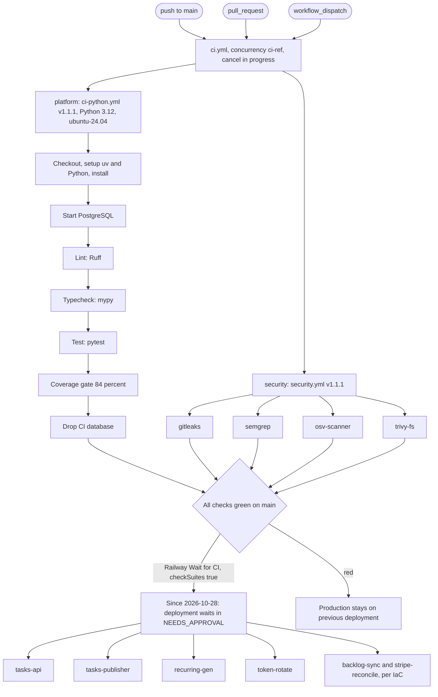

# 15 — CI/CD pipeline

Sources: `.github/workflows/ci.yml`, `bookchaowalit/platform-ci-workflows` `.github/workflows/ci-python.yml` และ `security.yml` @ `87dc5e1c` (job/step names via `gh api`), `.railway/railway.ts`, `README.md` (Token rotation), `Dockerfile`, ops record: railway-deploy-approval-gate (2026-11-03)

- CI ใช้ GitHub-hosted runner เพราะ repo เป็น public (comment ใน `ci.yml`)
- Coverage threshold: ratchet "measured 86.86% on 2026-10-22 (threshold = measured - 2)"
- Docker build เกิดใน Railway (ไม่มี image build/scan ใน GitHub Actions)
- Dependency updates: `renovate.json`

## Open questions

- `backlog-sync` และ `stripe-reconcile` เชื่อม GitHub source แล้วหรือยัง? runbooks (2026-10-24/25) บอกว่า deploy ด้วย `railway up` ของ `git archive` เพราะ `serviceConnect` ถูกปฏิเสธ แต่ IaC ประกาศ `source: github`
- ไม่มี post-deploy smoke ใน pipeline (verify อยู่ที่ healthcheck `/health` ของ Railway และ uptime monitor)
