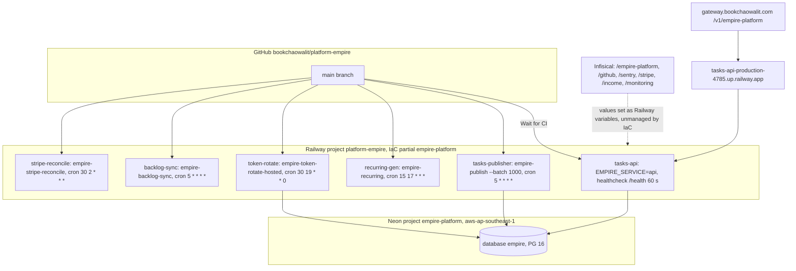

# 16 — Deployment

Sources: `.railway/railway.ts`, `Dockerfile`, `docker-entrypoint.sh`, `PRODUCT.md` (Operating Context), `docs/runbooks/tasks-cutover-and-rollback.md` (Hosted deployment, Neon region and PG 16), `docs/runbooks/backlog-sync.md` and `stripe-reconcile.md` (Infisical paths), ops record: api-gateway-edge (2026-11-03)

## Environment variables per service (names only)

| Service | Variables (from repo docs/code) |
|---|---|
| `tasks-api` | `EMPIRE_SERVICE=api`, `EMPIRE_DB_MODE=hosted`, `EMPIRE_DB_URL_TASKS_API`, `TASKS_API_JWT_PUBLIC_KEY_PEM`, `TASKS_API_JWT_NEXT_PUBLIC_KEY_PEM` (rollover), `TASKS_API_JWT_ISSUER`, `TASKS_API_HOST`, `PORT`, optional `IDENTITY_SHADOW_URL`, `SENTRY_DSN`, `SENTRY_ENVIRONMENT` |
| `tasks-publisher` | `EMPIRE_SERVICE=publisher`, `EMPIRE_DB_MODE=hosted`, `EMPIRE_DB_URL_TASKS_PUBLISHER`, `EMPIRE_DB_URL_GRAPH_API` |
| `recurring-gen` | `EMPIRE_SERVICE=recurring`, `EMPIRE_TASKS_API_URL`, `RECURRING_GEN_TOKEN` |
| `token-rotate` | `EMPIRE_SIGNING_PRIVATE_KEY_PEM`, `EMPIRE_TOKEN_ISSUER`, `EMPIRE_DB_URL_EMPIRE_MIGRATOR`, `EMPIRE_DB_URL_PLATFORM_API`, provider credentials (Railway, Vercel, Cloudflare, Infisical), `MONITOR_URL`, `HEARTBEAT_TOKEN` |
| `backlog-sync` | see [`docs/runbooks/backlog-sync.md`](../runbooks/backlog-sync.md) (reused) |
| `stripe-reconcile` | see [`docs/runbooks/stripe-reconcile.md`](../runbooks/stripe-reconcile.md) (reused) |

Sources: `docs/runbooks/tasks-cutover-and-rollback.md`, `src/empire_platform/hosted_rotate.py` docstring, `services/tasks/tasks_api/app.py` (`server_config`), `README.md`

## Migration

ไม่มีขั้น migrate ใน image หรือ entrypoint; migration รันโดย operator: `empire-neon provision` (apply migrations as `empire_migrator`) แล้ว `empire-neon verify`

Sources: `src/empire_platform/neon.py`, `docker-entrypoint.sh`

## Open questions

- Railway region ของ project นี้ (ไม่มีใน IaC)
- `.railway/railway.ts` ตั้งชื่อ Railway project `platform-empire` แต่ cutover log (2026-10-09) เรียก `empire-platform`: ถูกเปลี่ยนชื่อหรือเป็นคนละ project
