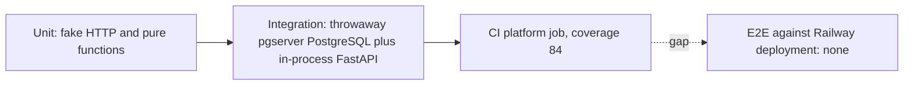

# 17 — Test coverage matrix

ระดับ test ใน repo นี้:
- **unit**: ไม่ต้องใช้ DB, ใช้ fake HTTP / transport (`test_recurring.py` "against a fake Tasks API (no database)", `test_hosted_rotate.py` "provider pushes over HTTP")
- **integration**: ใช้ PostgreSQL จริงแบบ throwaway ต่อ session (`tests/conftest.py`: `pgserver` cluster, bootstrap roles, apply migrations) และ FastAPI app ใน process
- **e2e**: ไม่มี test ที่เรียก production หรือ deployment จริง

รวม 34 test files, 333 test functions (นับ `def test_`); CI coverage gate 84 % (วัดได้ 86.86 % เมื่อ 2026-10-22)

| Feature | Unit | Integration | E2E | Test files |
|---|---|---|---|---|
| Authorization PDP, conformance, TOCTOU | — | yes | gap | `test_authz.py` |
| Delegation and automation least privilege | — | yes | gap | `test_delegation.py`, `test_automations.py` |
| Tenant isolation, RLS bypass | — | yes | gap | `test_tenant_isolation.py`, `test_role_cannot_bypass_rls.py` |
| Tasks API routes | — | yes | gap | `test_tasks_api.py`, `test_tasks_relations.py`, `test_tasks_writer_parity.py` |
| Tasks contract (OpenAPI, events) | — | yes | — | `test_tasks_contract.py`, `test_task_store_contract.py` |
| Outbox and graph | — | yes | gap | `test_graph.py` |
| Platform HTTP for cells | — | yes | gap | `test_platform_http.py`, `test_cells_reconcile.py` |
| Identity shadow | partly (mirror) | yes (role, parity) | gap | `test_identity_shadow.py` |
| Local MCP adapter | yes (`test_mcp_errors.py`) | yes (`test_mcp.py`) | gap | `test_mcp.py`, `test_mcp_errors.py` |
| Hosted MCP (retired) | yes | yes | — | `test_remote_mcp.py` |
| Token exchange prototype | yes | — | — | `test_token_exchange.py` |
| JWKS | yes | — | gap | `test_jwks.py` |
| Hosted config, publisher loop, keys | yes | yes | — | `test_hosted_deploy.py` |
| Token rotation | yes | yes (provision) | gap | `test_hosted_rotate.py`, `test_rotate.py` |
| Platform audiences and permissions | yes | — | — | `test_platform_audiences.py`, `test_platform_permissions.py` |
| Recurring generation | yes | — | gap | `test_recurring.py` |
| Backlog sync | yes (mapping, parsing) | yes ("against the real API") | gap | `test_backlog_sync.py` |
| Stripe reconcile | yes (fake HTTP, no DB fixture) | — | gap | `test_stripe_reconcile.py` |
| Monitor | yes (`test_monitor_notify.py`) | yes (`test_monitor.py`) | gap | `test_monitor.py`, `test_monitor_notify.py` |
| Neon provisioning | yes (API calls) | yes (role attributes) | gap | `test_neon.py` |
| Migrations | — | yes | — | `test_migrations.py` |
| Backup / restore | — | yes (local synthetic drill) | gap (hosted drill) | `test_recovery_rehearsal.py` |
| Sentry scrubbing | yes | — | — | `test_sentry.py` |
| Resilience and timings | — | yes | — | `test_resilience.py` |
| Cutover legacy (`cutover.py`) | — | — | — | none; rollback tests removed after cutover |
| Graph read API (`graph_service/app.py`) | — | yes, via `tests/graph_world.py` (`create_graph_app`) | — | `test_graph.py`, `test_mcp.py`, `test_tasks_relations.py`, `test_recovery_rehearsal.py`, `test_remote_mcp.py` |

Unit / integration ระบุจาก docstring ของไฟล์และการใช้ fixture `cluster` ของ conftest; บางไฟล์มีทั้งสองแบบ

Sources: `tests/*.py` (docstrings, `def test_` counts), `tests/conftest.py`, `tests/graph_world.py`, `.github/workflows/ci.yml`, `pyproject.toml` (`[tool.pytest.ini_options]`, `[tool.coverage.run]`)

## Open questions

- จะเพิ่ม post-deploy smoke (เช่น `/health`, `401` without token) เป็น e2e ใน pipeline หรือไม่
