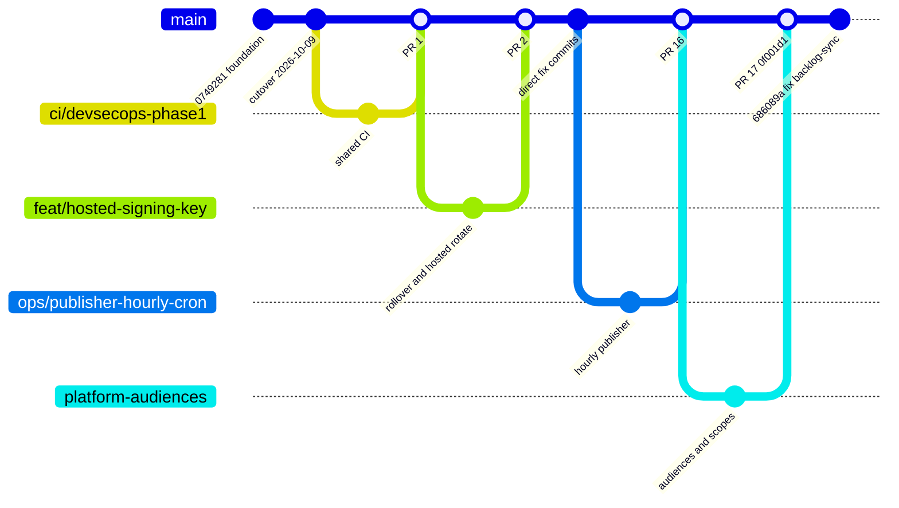
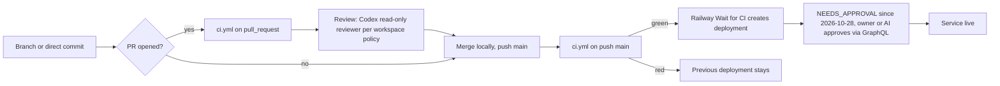

# 18 — Git and release workflow

ข้อเท็จจริงจาก history: 100 first-parent commits บน `main` ตั้งแต่ commit แรก 2026-10-09 ถึง 2026-11-03; 12 เป็น merge commits; 17 PRs (#1–#17) ทั้งหมด MERGED; อีก 88 เป็น commit ตรงบน first-parent ของ `main` (63 ก่อน CI run แรกบน `main` 2026-10-17, 25 หลังจากนั้น); PR บางตัวไม่มี merge commit บน first-parent (เช่น #4–#8 ที่ปรากฏเป็น commit เดี่ยว)
merge ทำใน local clone แล้ว push (เช่น `a0b87dc Merge branch payment-scopes`) ไม่ใช่ GitHub web merge

Sources: `git log --first-parent origin/main`, `gh pr list -R bookchaowalit/platform-empire --state all`, `.github/workflows/ci.yml`, `.railway/railway.ts`, `README.md`, ops record: railway-deploy-approval-gate (2026-11-03), central ADR-0003 (Codex reviewer, `FINAL=` verdict line)

- ไม่มี tag หรือ GitHub release; version ใน `pyproject.toml` คงที่ `0.1.0`
- remote branches ที่ยังค้าง: `docs/cd-github-wait-for-ci`, `feat/intake-x-feed-scopes`, `platform-audiences` (merged แล้ว)

## Open questions

- ควรบังคับ PR สำหรับทุกการเปลี่ยนแปลงบน `main` (branch protection) หรือคง direct commit ได้
- ลบ remote branches ที่ merge แล้วหรือไม่
