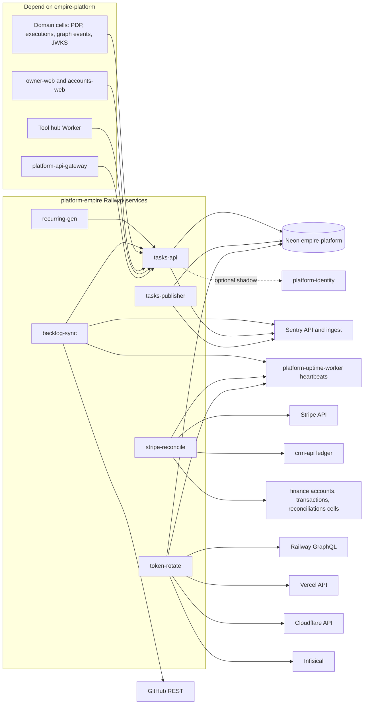

# 19 — Service dependency map (runtime)

Sources: `.railway/railway.ts`, `services/platform/platform_api/*.py`, `src/empire_platform/{backlog_sync,stripe_reconcile,hosted_rotate,recurring,_sentry}.py`, `services/tasks/tasks_api/publisher.py`, `contracts/automations/v1/deployments.json`, ops record: api-gateway-edge (2026-11-03), ops record: neon-platform-quota (2026-11-03)

## Critical path

`Neon empire-platform` → `tasks-api /v1/authz/decide` → ทุก cell ที่ใช้ PDP นี้ เมื่อ Neon compute quota หมด (2026-10-28 → 11-01) ทุก cell ตอบ 503 `authorization_unavailable` (ops record neon-platform-quota)

## Open questions

- cell ใดบ้างยังเรียก PDP นี้ และ cell ใดย้ายไป `platform-identity` แล้ว (ops record book-platforms-status: 8 platform services เชื่อ identity issuer ตั้งแต่ 2026-10-29)
