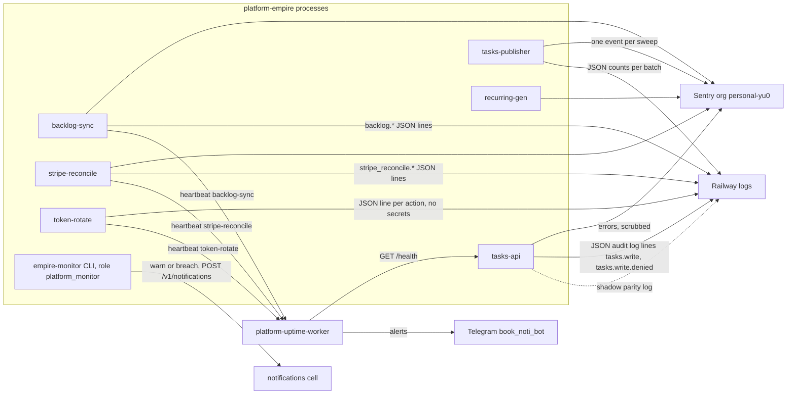

# 20 — Observability

Sources: `src/empire_platform/_sentry.py`, `services/tasks/tasks_api/app.py` (`audit_log`), `services/tasks/tasks_api/publisher.py`, `src/empire_platform/{backlog_sync,stripe_reconcile,hosted_rotate,monitor}.py`, `services/platform/platform_api/identity_shadow.py`, `PRODUCT.md`, `docs/runbooks/backlog-sync.md`, `docs/runbooks/stripe-reconcile.md`, ops record: prod-baseline-monitoring-backups (2026-11-03)

## What is watched

| Signal | Source | Threshold |
|---|---|---|
| tasks-api up | uptime worker `GET /health`; Railway healthcheck `/health` 60 s | per uptime worker config (outside repo) |
| token-rotate ran | heartbeat `token-rotate` | alert after 8 days without a run (`cell-executions-and-tokens.md`) |
| backlog-sync ran | heartbeat `backlog-sync` | `maxAgeHours: 3` proposed in runbook step 6 |
| stripe-reconcile ran | heartbeat `stripe-reconcile` | `maxAgeHours: 26` proposed in runbook step 4 ("Open") |
| recurring-gen ran | none | gap: no heartbeat in `recurring.py` |
| tasks-publisher ran | none | gap: exit code only; publisher `/health` exists only in loop mode |
| tasks lost, duplicate numbers | `empire-monitor` | any → breach |
| outbox oldest unpublished | `empire-monitor` | > 15 min warn, > 60 min breach |
| outbox retries | `empire-monitor` | ≥ 3 warn |
| graph not applying | `empire-monitor` | > 60 min warn |
| write switch off | `empire-monitor` | warn |
| cross-workspace denials 24 h | `empire-monitor` | any → warn |
| cell execution running | `empire-monitor` | > 15 min warn, > 24 h breach |
| token expiry (token dir) | `empire-monitor` | ≤ 7 days warn, expired breach |
| 5xx rate, p95 | `PRODUCT.md` Measures says Sentry and uptime worker | no metric code in repo ("needs request metrics", cutover runbook) |

Sources: `src/empire_platform/monitor.py` docstring, `docs/runbooks/tasks-cutover-and-rollback.md` (Daily check), `docs/runbooks/cell-executions-and-tokens.md`

## Open questions

- `empire-monitor` รันอัตโนมัติที่ใด (crontab ของ owner 02:17 เป็นข้อมูล 2026-10-09) และ `--notify` เปิดอยู่หรือไม่
- เกณฑ์ outbox > 15/60 min ชนกับ publisher ที่รันรายชั่วโมงตั้งแต่ 2026-10-28 (lag ได้ถึง 60 min โดยออกแบบ) → ควรปรับ threshold (PRODUCT.md ระบุ `[ต้องยืนยัน]`)
- heartbeats `backlog-sync` และ `stripe-reconcile` ถูกเพิ่มใน `platform-uptime-worker` `src/targets.ts` แล้วหรือยัง (runbook บอกเป็นขั้นที่ยังเปิด)
- ไม่มี tracing/metrics; Sentry tracing ปิดโดยตั้งใจ
