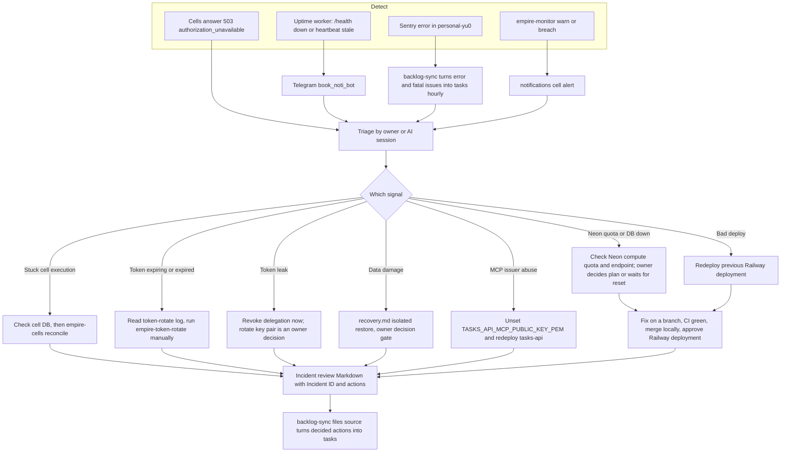

# 21 — Incident response

Sources: `docs/runbooks/cell-executions-and-tokens.md`, `docs/runbooks/recovery.md`, `docs/runbooks/remote-mcp.md` (Kill switch), `README.md` (roll back by redeploying an earlier deployment), `src/empire_platform/backlog_sync.py` (Sentry + incident review sources), `src/empire_platform/monitor.py` (`notify`), ops record: neon-platform-quota (2026-11-03), ops record: prod-baseline-monitoring-backups (2026-11-03), ops record: railway-deploy-approval-gate (2026-11-03)

## Past incidents ที่บันทึกใน repo

| Date | Incident | Response recorded |
|---|---|---|
| 2026-10-09 | `pg_dump` traceback printed the migrator URL | migrator password rotated via Neon API; errors redacted (`tasks-cutover-and-rollback.md`) |
| 2026-10-09 | tests wrote to production for ~10 min (63 test tasks) | found via outbox and execution log, reverted through the API; tests isolated with `EMPIRE_CLIENT_CONFIG` |
| 2026-10-28 | Neon compute quota exhausted, every cell 503 | publisher moved to hourly cron (PR #16); owner waited for 11-01 reset (ops record neon-platform-quota) |

## Open questions

- ไม่มี severity ladder, on-call หรือ incident template ใน repo นี้; ใช้ template กลาง (`Incident ID/severity` ที่ backlog-sync อ่าน) หรือไม่
- ใครเป็นผู้ approve deployment ระหว่าง incident (owner หรือ AI) ภายใต้ `NEEDS_APPROVAL`
