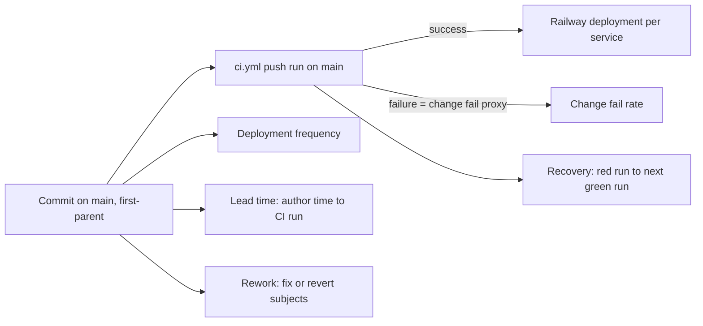

# 22 — DORA metrics

ช่วงวัด: 90 วัน **2026-08-05 → 2026-11-03** แต่ repo เริ่มที่ commit แรก **2026-10-09** (`0749281`) จึงมีข้อมูลจริง 26 วัน; CI run history เริ่ม 2026-10-17 (PR #1) — วัดเมื่อ 2026-11-03 จาก worktree ที่ `git fetch` แล้ว, `origin/main` = `686089a`

**นิยาม deployment ของ repo นี้:** commit ที่เข้า `main` (first-parent) และผ่าน CI → Railway Wait for CI สร้าง deployment ของทุก service (ADR-0004) ข้อมูล deployment ฝั่ง Railway (สำเร็จ/ล้ม/approve) **ไม่ได้ดึงมา** ในงานนี้ จึงใช้ CI บน `main` เป็นตัวแทน

| Metric | How measured here | Value | Command |
|---|---|---|---|
| Deployment frequency | first-parent commits on `origin/main` | **100 commits on 17 distinct days** (2026-10-09 → 11-03) ≈ 27 / week over the 26 active days; by ISO week W41 = 45, W42 = 30, W43 = 18, W44 = 4, W45 = 3 | `git log --first-parent --since=2026-08-05 --format='%ad' --date=format:%G-W%V origin/main \| sort \| uniq -c` |
| Lead time for changes | commit author time → creation of the first `ci.yml` push run on `main` that contains it (64 commits since 2026-10-17) | **median ≈ 0 h** (0.01 h), p90 2.6 h, max 118.6 h | `gh run list -R bookchaowalit/platform-empire --limit 300 --json headSha,createdAt,headBranch,event` + `git log --format='%H %aI' <prev>..<sha>` per run |
| Change fail rate | `ci.yml` push runs on `main` with `conclusion=failure` | **1 / 34 = 2.9 %** (`2a93bb5` stripe-reconcile, 2026-10-25); plus 2 `cancelled` (concurrency) | `gh run list -R bookchaowalit/platform-empire --limit 300 --json conclusion,headBranch,event,headSha` |
| Failed deployment recovery time | red `ci.yml` run on `main` → next green run (`updatedAt` to `updatedAt`) | **7 min** (`2a93bb5` → `6d19c6c` "fix(stripe-reconcile): type the payout destination for mypy", 2026-10-25); production recovery: not computed | same `gh run list` output ordered by `createdAt` |
| Deployment rework rate | first-parent commits whose subject starts with `fix`/`Revert`/`revert` or is `Merge branch 'fix/` | **19 / 100 = 19 %** | `git log --first-parent --since=2026-08-05 --format='%h %s' origin/main \| grep -E "^[0-9a-f]+ (fix\|revert\|Revert)\|Merge branch 'fix/"` |

Sources: `git log origin/main`, `gh run list -R bookchaowalit/platform-empire` (69 runs: 34 push on `main`, 35 pull_request), `.github/workflows/ci.yml`, `.railway/railway.ts`

## Caveats

- 63 ของ 100 commits เกิดก่อน CI มีบน `main` (2026-10-17): lead time และ change fail rate วัดได้เฉพาะ 37 commits หลังจากนั้น (34 push runs เพราะ concurrency ยกเลิก/รวมบางตัว)
- CI แดงบน `main` ไม่ได้ deploy (Wait for CI) จึง "change fail" ที่นับนี้ไม่ใช่ production failure; production failure ต้องดูจาก Railway deployment status และ uptime/Sentry ซึ่งไม่ได้ดึง
- ตั้งแต่ 2026-10-28 deployment รอ `NEEDS_APPROVAL` (ops record railway-deploy-approval-gate) ทำให้ lead time ถึง production ยาวกว่าที่วัดได้จาก CI
- deploy frequency นับ commit ไม่ใช่ deployment จริง: Railway deploy 4–6 services ต่อ commit (และ `backlog-sync`/`stripe-reconcile` อาจ deploy ด้วยมือ ดู 15)
- rework นับจากข้อความ commit เท่านั้น

## Open questions

- จะดึง Railway deployment history (`railway deployment list --json` ต่อ service) มาคำนวณ DF/CFR/MTTR จริงหรือไม่
- ต้องการเก็บค่าเหล่านี้อัตโนมัติ (scorecard) หรือคำนวณมือรายไตรมาส
